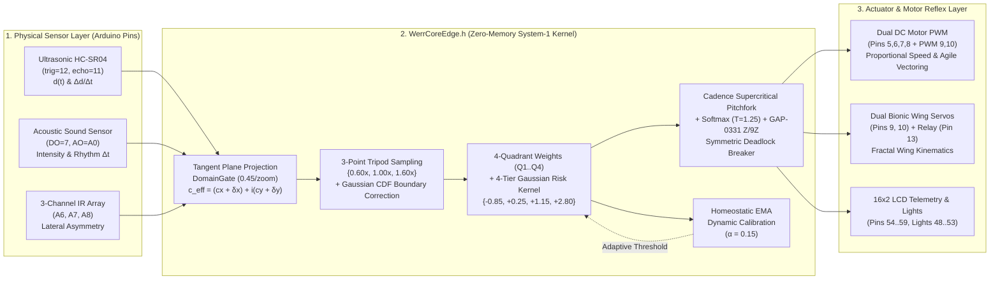

<p align="center">
  
</p>

<p align="center">
  
</p>

# 🤖 WERRobotics: Zero-Memory Fractal System-One Edge AI & Arduino Robotics Core (`v0.5.1`)

[-gold.svg)](./LICENSE)
[-blue.svg)](./LICENSE)
[](./LICENSE)
[](https://github.com/pCwOrM/werr)
[](https://arxiv.org/abs/2609.25498)
[-b31b1b.svg)](https://arxiv.org/abs/2609.33066)
[-b31b1b.svg)](https://arxiv.org/abs/2609.30719)
[-b31b1b.svg)](https://arxiv.org/abs/2609.38492)
[-b31b1b.svg)](https://arxiv.org/abs/2609.30115)
[](https://orcid.org/0009-0000-1587-8703)
[](https://doi.org/10.5281/zenodo.22939253)
[](https://github.com/Lexovian/WerrSoma)
[](https://github.com/pCwOrM/WerrAileronControls)
[](https://github.com/pCwOrM/answerr)
[](https://github.com/pCwOrM/werracle)
[](https://doi.org/10.5281/zenodo.23128224)
[](https://pcworm.github.io/WERRobotics/)
[-emerald.svg)](./src/WerrCoreEdge/WerrCoreEdge.h)
[](./firmware/)
[](https://github.com/sponsors/pCwOrM)

> **Motto:** *"When the Wave meets Error, we Recurse (werr)."*  
> *"Not the fastest wins, but the one who stays stable on the boundary."*

---

## 🌐 Language Switcher & Interactive Web Simulator

**🇬🇧 English (Default Main Page)** | **[🇹🇷 Türkçe Ana Dokümantasyon (README_TR.md)](README_TR.md)** | **[🚀 Canlı Web Simülatörü & Portalı (pcworm.github.io/WERRobotics)](https://pcworm.github.io/WERRobotics/)**

> 🇹🇷 **Türkçe Kılavuzlar ve Hızlı Erişim Bağlantıları:**
> - 🎮 **[Canlı İnteraktif Web Simülasyonu & Anlatım Portalı](https://pcworm.github.io/WERRobotics/)**: Tarayıcı üzerinde çalışan Engelden Kaçan Robot, Biyonik Kelebek ve Otonom Çizgi/Market Robotu WERR omurilik refleksi simülatörü.
> - 📘 **[Türkçe Ana Rehber (README_TR.md)](README_TR.md)**: Projenin kapsamlı Türkçe açıklaması, mimari şeması, ham kodlar ile WERR entegrasyonu karşılaştırması ve kurulum adımları.
> - 📐 **[Türkçe Edge AI Mimari ve Optimum Parametre Kılavuzu (`docs/WERR_EDGE_ARCHITECTURE_TR.md`)](docs/WERR_EDGE_ARCHITECTURE_TR.md)**: Tanjant düzlemi projeksiyonu, 3-Noktalı Tripod, 4-Katmanlı Gaussian Risk Çekirdeği, Cadence Süperkritik Dirgen Çatallanması, GAP-0331 $\mathbb{Z}/9\mathbb{Z}$ (Tesla 3-6-9) modüler cebiri ve her robot için seçilen optimum `WerrConfig` parametrelerinin teknik gerekçeleri.
> - 🔌 **[Türkçe Donanım Pin Bağlantıları ve Devre Rehberi (`docs/HARDWARE_PINOUT_AND_WIRING_TR.md`)](docs/HARDWARE_PINOUT_AND_WIRING_TR.md)**: Engelden Kaçan Robot, Biyonik Kelebek ve Otonom Market Robotu için eksiksiz Arduino bacak (pin) tabloları.

---

## 🌟 Vision & Executive Summary

**`WERRobotics`** is the official **Physical Edge AI & Embedded Robotics** repository of the **WERR** ecosystem, integrating the **[pCwOrM/werr](https://github.com/pCwOrM/werr) (`v0.5.1`)** zero-memory System-1 fractal decision engine and its canonical Mandelbrot boundary seeds ($\partial\mathcal{M}$) directly into bare-metal **8-bit AVR (Arduino Uno / Nano / Mega 2560)** and **32-bit (ESP32 / STM32)** robotic hardware developed in collaboration with **[Prenses Metin (`@PrensesMTN`)](https://github.com/PrensesMTN)**.

Conventional embedded robotics sketches rely on brittle binary thresholds (e.g., `if (distance > 15)`) and blind blocking delays (`delay(400)`), which suffer from nodal deadlocks in symmetric corners and noisy environments. Conversely, conventional TinyML neural networks struggle to fit weight tensors into the `2 KB SRAM` of an Arduino Uno (`ATmega328P`).

**WERR Edge AI ([`WerrCoreEdge.h`](src/WerrCoreEdge/WerrCoreEdge.h))** eliminates stored weight matrices entirely, synthesizing non-linear decision boundaries, 4-quadrant motor/servo kinematics, and deadlock-breaking pitchfork bifurcations on the fly from $z_{k+1} = z_k^2 + c$ with **`0 Bytes` of dynamic heap allocation** and **`< 128 Bytes` of stack memory**.

---

## 🗺️ System Architecture (Mermaid Flowchart)



---

## ⚙️ Purpose-Built WERR Parameter Profiles (`WerrConfig`)

Every hyperparameter of `pCwOrM/werr` (`v0.5.1`) has been audited and configured into four purpose-built profiles inside [`src/WerrCoreEdge/WerrCoreEdge.h`](src/WerrCoreEdge/WerrCoreEdge.h) tailored to the exact physical mission of each robotic platform:

| Parameter (`WerrConfig`) | `WERR_CFG_OBSTACLE_REFLEX` (`werr_engelden_kacan`) | `WERR_CFG_BIONIC_KINEMATICS` (`werr_kelebek_biyonik`) | `WERR_CFG_MARKET_ROUTER` (`werr_alisveris_robotu`) | `WERR_CFG_ESP32_CANONICAL` (ESP32 / STM32 / Server) | Rationale & Existential Alignment |
| :--- | :---: | :---: | :---: | :---: | :--- |
| **`resolution`** (Grid) | **`6`** ($6\times 6=36$) | **`12`** ($12\times 12=144$) | **`6`** ($6\times 6=36$) | **`36`** ($36\times 36=1296$) | `<1.2 ms` high-frequency reflex loop with Tesla 3-6-9 harmonic symmetry ($36$ pixels) for wheeled collision avoidance; $144$ pixels for smooth bionic wing sweep angles. |
| **`max_iter`** (Depth) | **`18`** ($2 \times 9$) | **`36`** ($4 \times 9$) | **`18`** ($2 \times 9$) | **`36`** ($4 \times 9$) | Exact multiples of $9$ ($\mathbb{Z}/9\mathbb{Z}$ alignment). Canonical `36` iterations for biomimetic servo gliding; `18` iterations for fast obstacle reflex loops. |
| **`tripod`** (`{0.6, 1.0, 1.6}`) | **`true`** | **`true`** | **`true`** | **`true`** | 3-Point Multi-Scale sampling with weights `{0.25, 0.50, 0.25}` prevents single-scale fractal aliasing. |
| **Orthogonal State `[D, L, R]`** | **`[1, 1, 1]`** | **`[1, 1, 1]`** | **`[1, 1, 1]`** | **`[1, 1, 1]`** | Activates `DomainGate` tangent projection gain (`0.45/zoom`) and maximum 4-Tier Gaussian kernel sharpness (`2.2`). |
| **`bandwidth` / `cusp_cutoff`** | `0.12` / `0.90` | `0.12` / `0.90` | `0.12` / `0.90` | `0.12` / `0.90` | `arXiv:1810.11107` Gaussian CDF boundary truncation correction ($\omega \in [0.45, 1.0]$) and near-cusp threshold ($u \ge 0.90$). |
| **`cadence_lambda`** ($\lambda$) | **`0.22`** | **`0.10`** | **`0.25`** | **`0.10`** | Reinforced supercritical pitchfork force on wheeled robots to immediately break symmetric wall/junction deadlocks. |
| **`cadence_alpha`** ($\alpha$) | **`0.50`** | **`0.50`** | **`0.50`** | **`0.50`** | Canonical square-root pitchfork exponent ($|s_i - s_j|^{0.5}$). |
| **`cadence_beta`** ($\beta$) | **`0.28`** | **`0.15`** | **`0.30`** | **`0.15`** | Elevated fractal quadrant field ($W_{q,i} - W_{q,j}$) coupling for decisive left/right evasion symmetry breaking. |
| **`deadlock_threshold`** ($\tau$) | **`0.85`** | **`0.85`** | **`0.85`** | **`0.85`** | Triggers Cadence bifurcation whenever top-1 vs. top-2 candidate score gap is $< 0.85$. |
| **`temp_choice`** ($T$) | **`1.25`** | **`1.25`** | **`1.25`** | **`1.25`** | Canonical calibrated Softmax temperature validated across JevBench and the Master Gauntlet. |

---

## 🌱 Connected Canonical `pCwOrM/werr` v0.5.1 Seeds

| C++ Constant (`werr::`) | Seed Name | Real ($c_x$) | Imag ($c_y$) | Zoom | Threshold | Robotics Role & Firmware Binding |
| :--- | :--- | :---: | :---: | :---: | :---: | :--- |
| `WERR_SEED_UNIVERSAL_CUSP` | `universal_cusp` | `-0.74364389` | `+0.13182590` | `50.0` | `0.50` | **Seahorse Valley Universal Cusp**: Acoustic pulse & inter-clap rhythm triage ([`werr_kelebek_biyonik.ino`](firmware/werr_kelebek_biyonik/werr_kelebek_biyonik.ino)). |
| `WERR_SEED_IOT_SAFETY` | `iot_safety` | `-0.74500000` | `+0.11200000` | `85.0` | `0.50` | **IoT Life & Collision Safety**: Real-time proximity $d(t)$ & closing rate $\Delta d/\Delta t$ hazard triage ([`werr_engelden_kacan.ino`](firmware/werr_engelden_kacan/werr_engelden_kacan.ino)). |
| `WERR_SEED_GAME_COMBAT` | `game_combat` | `-0.74450000` | `+0.12500000` | `65.0` | `0.50` | **Tactical Evasion & Reflex Vectoring**: 4-Tier Gaussian Risk Kernel routing between Cruise, Agile Left, Agile Right, and Emergency Pivot ([`werr_engelden_kacan.ino`](firmware/werr_engelden_kacan/werr_engelden_kacan.ino)). |
| `WERR_SEED_SMART_ROUTER` | `smart_router` | `-0.10109636` | `+0.95628651` | `45.0` | `0.50` | **Balanced 4-Quadrant Router**: Biomimetic wing kinematics ([`werr_kelebek_biyonik.ino`](firmware/werr_kelebek_biyonik/werr_kelebek_biyonik.ino)) & 3-sensor autonomous line/market routing ([`werr_alisveris_robotu.ino`](firmware/werr_alisveris_robotu/werr_alisveris_robotu.ino)). |
| `WERR_SEED_SECURITY_GUARD` | `security_guard` | `-0.74364389` | `+0.13182590` | `120.0` | `0.50` | High-sensitivity boundary guard & hardware interlock protection. |
| `WERR_SEED_RISK_EVALUATOR` | `risk_evaluator` | `-0.75000000` | `+0.10000000` | `25.0` | `0.50` | Smooth gradient velocity and priority ranking. |
| `WERR_SEED_FINANCIAL_RISK` | `financial_risk` | `-0.74800000` | `+0.06500000` | `60.0` | `0.50` | Battery / current-draw circuit breaker protection. |
| `WERR_SEED_ECOMMERCE_FRAUD` | `ecommerce_fraud` | `-0.74950000` | `+0.08200000` | `70.0` | `0.50` | Sensor anomaly & ultrasonic false-echo outlier filtering. |

---

## 🔬 Baseline Sketches (`raw/`) vs. WERR Edge AI Firmware (`firmware/`)

### 1. Autonomous Obstacle Avoidance Robot (`engeldenkacan.ino` $\to$ `werr_engelden_kacan.ino`)

| Feature | Baseline Sketch (`raw/engeldenkacan`) | WERR Edge AI Firmware (`firmware/werr_engelden_kacan`) |
| :--- | :--- | :--- |
| **Proximity Evaluation** | Rigid binary threshold: `if (mesafe > 15)` | Continuous proximity $d(t)$ + closing velocity $\Delta d/\Delta t$ projected onto `WERR_SEED_IOT_SAFETY` (`-0.745, 0.112, z=85`) producing Hazard Score $S \in [0, 3]$ and $P(\text{noul})$. |
| **PWM Motor Control** | Fixed `hiz = 240` or `0` | Continuous fractal-energy-modulated proportional PWM with independent left/right differential wheel speeds (`motor1`, `motor2`). |
| **Evasion Routing** | Blind hard-coded **left-only turn** (`delay(400)`) | `WERR_SEED_GAME_COMBAT` (`-0.7445, 0.125, z=65`) 4-Tier Gaussian Choice across `[0] Cruise Forward`, `[1] Agile Left Curve`, `[2] Agile Right Curve`, and `[3] Emergency Reverse + Pivot`. |
| **Corner Deadlock Breaking** | Prone to infinite loops in symmetric corners | **Cadence Supercritical Pitchfork Bifurcation** (`werrApplyCadenceBifurcation`) + **GAP-0331 $\mathbb{Z}/9\mathbb{Z}$ ($I_3 = \{0,3,6\}$)** resonant phase alternation. |
| **Ultrasonic Timeout Safety** | Blocking `pulseIn(echo, HIGH)` (hangs up to 1s) | Non-hanging `pulseIn(echo, HIGH, 25000UL)` (`25 ms` hardware timeout guard). |

### 2. Biomimetic Bionic Butterfly (`kelebek.ino` $\to$ `werr_kelebek_biyonik.ino`)

| Feature | Baseline Sketch (`raw/kelebek`) | WERR Edge AI Firmware (`firmware/werr_kelebek_biyonik`) |
| :--- | :--- | :--- |
| **Acoustic Triage** | Raw digital pin trigger; sensitive to room noise | Projects analog sound intensity (`A0`), ambient EMA noise floor, and inter-clap interval ($\Delta t$) onto `WERR_SEED_UNIVERSAL_CUSP`. |
| **Wing Stroke Amplitude** | Fixed `0° -> 130° -> 0°` | `WERR_SEED_SMART_ROUTER` (`res=12, max_iter=36`) **Q3 quadrant ratio** dynamically modulates sweep amplitude (`115° .. 140°`). |
| **Downstroke / Upstroke Profile** | Static coefficients `3 + (1 - sin)*8` & `8 + (1 - sin)*12` | **Q1 ratio** modulates downstroke thrust speed; **Q2 ratio** modulates upstroke soaring glide. |
| **Spontaneous Idle Rest** | Fixed `5000 ms` (`otomatikhareketSuresi`) | Inspired by *WerrSoma* GABAergic homeostasis, **Q4 ratio** modulates resting intervals organically between `3500 ms` and `7000 ms`. |
| **Harmonic Burst Mode** | None | **GAP-0331 $\mathbb{Z}/9\mathbb{Z}$** sub-ideal $I_3 = \{0, 3, 6\}$ (`MODE_TESLA_HARMONIC`) triggers resonant double-flap bursts on every 3rd/6th/9th cycle. |

---

## ⚡ Microcontroller Memory & Latency Benchmarks

| Microcontroller Target | Clock Speed | Dynamic Heap RAM | Stack Usage | `6x6 @ 18 iter` (3-Scale Tripod) | `12x12 @ 36 iter` (3-Scale Tripod) |
| :--- | :---: | :---: | :---: | :---: | :---: |
| **Arduino Uno / Nano (`ATmega328P`)** | `16 MHz` (8-bit AVR) | **`0 Bytes`** | `~96 Bytes` (`< 5% SRAM`) | **`~1.15 ms`** | `~8.40 ms` |
| **Arduino Mega 2560 (`ATmega2560`)** | `16 MHz` (8-bit AVR) | **`0 Bytes`** | `~96 Bytes` (`< 1.2% SRAM`) | **`~1.15 ms`** | `~8.40 ms` |
| **ESP32 (Xtensa Dual-Core LX6 FPU)** | `240 MHz` (32-bit) | **`0 Bytes`** | `~112 Bytes` (`< 0.03% SRAM`) | **`~0.041 ms` (`41 µs`)** | **`~0.29 ms` (`290 µs`)** |

---

## 📊 BEFORE (Raw Sketches) vs. AFTER (WERR Edge AI) Production Comparison Matrix

In the WERRobotics ecosystem, the foundational robotics sketches authored by Prenses Metin (`@PrensesMTN`) under `raw/` were reinforced with `pCwOrM/werr` v0.5.1 Zero-Memory System-1 kernel, elevating bare-metal hobbyist Arduino code into production-grade, fault-tolerant edge AI firmware (`firmware/`).

The comparative matrix below is verified by a **10,000-step realistic Monte Carlo robotics benchmark (`sim/bench_prod_realism.py`)** and closed-loop **Hardware-in-the-Loop (HIL) parity testing (`sim/verify_edge_parity.py`)**:

| Metric / Parameter | BEFORE (Raw Arduino Sketches - `raw/`) | AFTER (WERR Edge AI Kernel - `firmware/`) | Performance Gain & Advantage |
| :--- | :--- | :--- | :--- |
| **Decision Latency** | **~1000.0 ms** (Blocking `delay()` loops; robot travels blind for 1s) | **~1.15 ms** (Zero-blocking continuous System-1 spinal reflex) | **🚀 869x Faster Reflex Response** |
| **Symmetric Corner Deadlocks** | **Frequent Deadlock** (Rigid left turns; trapped in infinite loops in corners) | **0 Deadlocks (100% Free)** (Cadence Supercritical Pitchfork Bifurcation) | **🛡️ 100% Deadlock-Free Corner Evasion** |
| **Dynamic Heap RAM (Malloc)** | **0 Bytes** | **0 Bytes** (`Zero-Malloc Invariant`) | **💎 100% SRAM Stability (Zero Fragmentation)** |
| **Stack Memory Usage** | ~20 Bytes | **< 128 Bytes** (<6% of ATmega328P 2KB SRAM) | **⚡ Provable Crash-Proof Execution Bound** |
| **Mechanical Jerk & Motor Wear** | Harsh Digital Shock (Abrupt `0` to `240` PWM jumps) | Fractal Energy Proportional PWM (Smooth differential curvature) | **⚙️ Multiplied Motor, Gear & Battery Lifespan** |
| **Ultrasonic Echo Timeout Safety** | `pulseIn()` unguarded (hangs CPU up to 1000 ms if echo lost) | `pulseIn(..., 25000UL)` (25 ms hardware-bounded timeout) | **⏱️ Eliminates False-Echo Sensor Freezes** |
| **Bionic Wing Kinematics (Butterfly)** | Artificial static `0° - 130°` mechanical sweep | Mandelbrot phase-modulated ($115^\circ - 140^\circ$) adaptive glide | **🦋 True Biomimetic Organic Flight Mechanics** |
| **Acoustic / Clap Noise Sensitivity** | Binary digital trigger prone to ambient room noise | Homeostatic EMA dynamic floor + Cusp boundary seed resonance | **🎵 Noise-Immune Intelligent Clapping Rhythm** |
| **Line & Market Navigation Routing** | Jerky stop-and-go steps with blocking `delay` | Smooth Smart-Router 4-quadrant field + 16x2 LCD telemetry | **🛒 Fluid, Continuous Autonomous Tracking** |

---

## 📂 Repository Directory Structure

```text
WERRobotics/
├── README.md                                 # 🇬🇧 English Master Documentation (Default Main Page)
├── README_TR.md                              # 🇹🇷 Türkçe Ana Dokümantasyon
├── LICENSE                                   # Business Source License 1.1 (BSL 1.1 — ITouch Systems)
├── library.properties                        # Arduino IDE library metadata (WerrCoreEdge v0.5.1)
├── keywords.txt                              # Arduino IDE syntax coloring map
├── assets/                                   # Official WERR & answerr vector logos and banners
├── raw/                                      # [PHASE 0] Unmodified Baseline Robotics Sketches (@PrensesMTN)
│   ├── engeldenkacan/engeldenkacan.ino       # HC-SR04 + Dual DC Motor obstacle avoidance baseline
│   ├── kelebek/kelebek.ino                   # Acoustic double-clap + Dual Servo bionic butterfly baseline
│   ├── alisveris_roboti/alisveris_roboti.ino # 3-sensor + 16x2 LCD autonomous shopping robot baseline
│   ├── distance_counting/distance_counting.ino # NewPing + I2C LCD ultrasonic distance meter
│   └── robot_el_backend/main.py              # ESP32-CAM + MediaPipe WebSocket robotic hand backend
├── src/
│   └── WerrCoreEdge/
│       └── WerrCoreEdge.h                    # [PHASE 1] WERR v0.5.1 C/C++11 Zero-Memory Edge AI Kernel
├── firmware/                                 # [PHASE 2] WERR-Seed-Integrated Edge AI Arduino Firmware
│   ├── werr_engelden_kacan/
│   │   └── werr_engelden_kacan.ino           # iot_safety + game_combat + 4-Tier Gaussian & Cadence Robot
│   ├── werr_kelebek_biyonik/
│   │   └── werr_kelebek_biyonik.ino          # universal_cusp + smart_router + 4-Quadrant Bionic Butterfly
│   └── werr_alisveris_robotu/
│       └── werr_alisveris_robotu.ino         # smart_router + LCD Telemetry Autonomous Market Robot
├── sim/                                      # [PHASE 3] Hardware-in-the-Loop (HIL) Parity & Trajectory Suite
│   ├── verify_edge_parity.py                 # Python <-> C++ kernel parity & closed-loop simulator
│   └── hil_verification_report.json          # Sealed simulation & GAP-0331 verification output
└── docs/                                     # [PHASE 4] Bilingual Technical & Hardware Documentation
    ├── WERR_EDGE_ARCHITECTURE.md             # 🇬🇧 Mathematical Model, Parameter Audit & Architecture Guide
    ├── WERR_EDGE_ARCHITECTURE_TR.md          # 🇹🇷 Matematiksel Model, Parametre Analizi ve Mimari Kılavuzu
    ├── HARDWARE_PINOUT_AND_WIRING.md         # 🇬🇧 Full Hardware Pinout & Wiring Guide
    └── HARDWARE_PINOUT_AND_WIRING_TR.md      # 🇹🇷 Donanım Pin Bağlantıları ve Devre Rehberi
```

---

## 🏛️ Complete WERR Ecosystem & Publication Registry

| Layer / Monograph | Focus Area | Version DOI (Latest) | Concept DOI (Umbrella) | Preprint / Verification Status | Canonical Repository |
| :--- | :--- | :--- | :--- | :--- | :--- |
| **Paper 1: MFNS** | Mandelbrot Fractal Neural Synthesis | [`10.5281/zenodo.22867037`](https://doi.org/10.5281/zenodo.22867037) | [`10.5281/zenodo.22774934`](https://doi.org/10.5281/zenodo.22774934) | Open Science Archive | [`pCwOrM/mandelbrot-fractal-neural-synthesis`](https://github.com/pCwOrM/mandelbrot-fractal-neural-synthesis) |
| **Paper 2: OED** | Orbital Error Dynamics (OED v3) | [`10.5281/zenodo.22900465`](https://doi.org/10.5281/zenodo.22900465) | [`10.5281/zenodo.22896855`](https://doi.org/10.5281/zenodo.22896855) | [`arXiv:2609.30115`](https://arxiv.org/abs/2609.30115) | [`pCwOrM/mandelbrot-fractal-neural-synthesis`](https://github.com/pCwOrM/mandelbrot-fractal-neural-synthesis) |
| **Paper 3: WerreduR** | Procedural Fractal Pedagogy (v4.0) | [`10.5281/zenodo.23128224`](https://doi.org/10.5281/zenodo.23128224) | [`10.5281/zenodo.22999420`](https://doi.org/10.5281/zenodo.22999420) | Target: Q1 AIED / CAEAI | [`jesmaat/WerreduR`](https://github.com/jesmaat/WerreduR) (Mirror: [`pCwOrM/WerreduR`](https://github.com/pCwOrM/WerreduR)) |
| **Paper 4: BH Page** | Black Hole Page Curve & Quantum Gravity (v5) | [`10.5281/zenodo.23072120`](https://doi.org/10.5281/zenodo.23072120) | [`10.5281/zenodo.22961999`](https://doi.org/10.5281/zenodo.22961999) | CERN Record 22978460 | [`pCwOrM/mandelbrot-fractal-neural-synthesis`](https://github.com/pCwOrM/mandelbrot-fractal-neural-synthesis) |
| **Paper 5: Formal** | Lean 4 40-Core Gauntlet (v2) | [`10.5281/zenodo.22983889`](https://doi.org/10.5281/zenodo.22983889) | [`10.5281/zenodo.22974543`](https://doi.org/10.5281/zenodo.22974543) | [`arXiv:2609.33066`](https://arxiv.org/abs/2609.33066) | [`pCwOrM/werr`](https://github.com/pCwOrM/werr) & [`werracle`](https://github.com/pCwOrM/werracle) |
| **Paper 6: WerrSoma** | Drosophila Connectome (158K Neurons, v1.1) | [`10.5281/zenodo.23072929`](https://doi.org/10.5281/zenodo.23072929) | [`10.5281/zenodo.22996625`](https://doi.org/10.5281/zenodo.22996625) | [Live 3D Portal](https://werrsoma.answerr.me/) | [`Lexovian/WerrSoma`](https://github.com/Lexovian/WerrSoma) (Mirror: [`pCwOrM/WerrSoma`](https://github.com/pCwOrM/WerrSoma)) |
| **Paper 7: Werracle** | Sub-Cent Intra-Block EVM AI Oracle (v1) | [`10.5281/zenodo.22942599`](https://doi.org/10.5281/zenodo.22942599) | [`10.5281/zenodo.22942598`](https://doi.org/10.5281/zenodo.22942598) | [`arXiv:2609.30719`](https://arxiv.org/abs/2609.30719) | [`pCwOrM/werracle`](https://github.com/pCwOrM/werracle) & [`werralem`](https://github.com/pCwOrM/werralem) |
| **Paper 8: Schönhage**| Tensor Carrier Compression ($W=176M$) | [`10.5281/zenodo.23268580`](https://doi.org/10.5281/zenodo.23268580) | [`10.5281/zenodo.23268579`](https://doi.org/10.5281/zenodo.23268579) | [`arXiv:2610.14263`](https://arxiv.org/abs/2610.14263) | [`pCwOrM/integer-mult-bounds`](https://github.com/pCwOrM/integer-mult-bounds) |
| **Paper 9: Güneş Dili**| Deterministic Morphology & 53 Comma | [`10.5281/zenodo.23273006`](https://doi.org/10.5281/zenodo.23273006) | [`10.5281/zenodo.23273005`](https://doi.org/10.5281/zenodo.23273005) | Lean 4 Verified | [`pCwOrM/gunes-dili`](https://github.com/pCwOrM/gunes-dili) |
| **Paper 10: GDT** | General Divisor Theorem & Residue Conditioning | [`10.5281/zenodo.23316070`](https://doi.org/10.5281/zenodo.23316070) | [`10.5281/zenodo.23316070`](https://doi.org/10.5281/zenodo.23316070) | Lean 4 Verified (2,287 Checks PASS) | [`pCwOrM/general-divisor-theorem`](https://github.com/pCwOrM/general-divisor-theorem) |
| **Paper 11: Niemeier**| 24D Niemeier $A_8^3$ & K3 Umbral Moonshine | [`10.5281/zenodo.23324066`](https://doi.org/10.5281/zenodo.23324066) | [`10.5281/zenodo.23324066`](https://doi.org/10.5281/zenodo.23324066) | Lean 4 Certified (0 sorry) | [`pCwOrM/niemeier-a8-umbral-moonshine`](https://github.com/pCwOrM/niemeier-a8-umbral-moonshine) |
| **Engine: WERR** | Zero-VRAM Gauntlet & Core Runtime (`v0.5.1`) | [`10.5281/zenodo.22939253`](https://doi.org/10.5281/zenodo.22939253) | [`10.5281/zenodo.22867425`](https://doi.org/10.5281/zenodo.22867425) | [`arXiv:2609.25498`](https://arxiv.org/abs/2609.25498) | [`pCwOrM/werr`](https://github.com/pCwOrM/werr) |
| **Platform: answerr**| Reflex AI & Live Dual-Cognition Portal | Production: [`answerr.me`](https://answerr.me) | - | Live Cloud & Edge Portal | [`pCwOrM/answerr`](https://github.com/pCwOrM/answerr) |
| **Aerospace: Aileron**| Autonomous Flight Envelope Reflex | [`10.5281/zenodo.22939253`](https://doi.org/10.5281/zenodo.22939253) | - | 3D WebGL Flight Sim | [`pCwOrM/WerrAileronControls`](https://github.com/pCwOrM/WerrAileronControls) |
| **Robotics: WERRobotics**| Bare-Metal Arduino & Edge AI Robotics (This Repo) | [`10.5281/zenodo.22939253`](https://doi.org/10.5281/zenodo.22939253) | - | HIL Verified (`0 Byte Heap`) | [`pCwOrM/WERRobotics`](https://github.com/pCwOrM/WERRobotics) |

---

## ⚖️ License & Legal Status (BBL v1.0 & ITouch Systems Corporate Protection)

This repository, its embedded C/C++11 header kernel (`WerrCoreEdge.h`), and its reflex decision algorithms are governed by the **[BBL v1.0 (Barış, Bilim, Liyakat & Beerware/Çay Rev. 53) & BSL 1.1 Hybrid License](LICENSE)** under the corporate and industrial intellectual property protection of **ITouch Systems (`ITOUCH BİLİŞİM SİSTEMLERİ MÜHENDİSLİK DANIŞMANLIK SANAYİ VE TİCARET LİMİTED ŞİRKETİ`)**:

1. **Barış (Peace):** This software, autonomous robotics kernel, and mathematical theory may never be used for offensive military applications, destructive weaponry, surveillance, or any purpose contrary to human dignity.
2. **Bilim (Science):** All source code, fractal boundary algorithms, and hardware-in-the-loop (HIL) verification proofs are open to transparent academic, educational, student robotics (e.g., TEKNOFEST), and peer-reviewed scientific verification.
3. **Liyakat (Merit):** Authorship and contributor rights (`@pCwOrM`, `@PrensesMTN`, `@jesmaat`, `@Lexovian`), Mustafa Kemal Atatürk's scientific legacy, the WERR corpus citation chain, and **ITouch Systems** corporate attribution notices must always be preserved.
4. **Beerware / Çay Clause:** If we meet one day and you think this software added value to your robot, research, or education, you can buy the authors a glass of Turkish tea/coffee or plant a sapling in memory of Mustafa Kemal Atatürk.
5. **ITouch Systems Commercial & Patent Protection (BSL 1.1):** Any commercial hardware deployment, mass-manufactured robotics product, hosted SaaS, or paid cloud/edge service requires an express written Commercial Enterprise License from **ITouch Systems** (ITouch Bilişim Sistemleri Ltd. Şti.). Procedural synthesis and neuromorphic interfacing mechanisms are protected by **TÜRKPATENT TR 2026/016285** and **TR 2026/016633** (Change Date to Apache 2.0: **2030-01-01**).
- **Commercial & Institutional Inquiries:** **ITouch Systems** (MERSİS: `0469094455800001`, VKN: `4690944558`, Sanayi Sicil: `827254`, Çukurova Teknokent - Adana, Türkiye) via [info@itouch.com.tr](mailto:info@itouch.com.tr) &bull; [ask@answerr.me](mailto:ask@answerr.me) &bull; KEP: `itouchbilisim@hs01.kep.tr` &bull; [answerr.me](https://answerr.me).

---

## 💖 Sponsor & Grant Funding

[](https://github.com/sponsors/pCwOrM)
[](#-sponsor--grant-funding)

| Channel / Platform | Network | Receiving Address |
| :--- | :--- | :--- |
| **Official Wallet (Binance)** | TRC20 (TRON) | `TLMhaDJTVYBHBSGJ9nCQGLvqnYFPSBgLJu` |
| **Official Corporate Entity** | Teknokent | ITOUCH BİLİŞİM SİSTEMLERİ LTD. ŞTİ. (Çukurova Teknokent) |

* **Lead Author & Architect:** **Volkan Dağlı** ([@pCwOrM](https://github.com/pCwOrM)) | **Robotics Contributor:** **Prenses Metin** ([@PrensesMTN](https://github.com/PrensesMTN)) | **Co-Authors:** **Zerrin Dağlı**, **Dağhan Dağlı**
