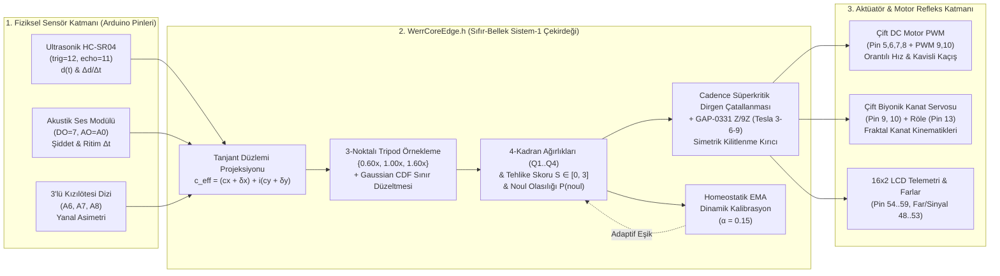

# 🤖 WerrRobotics — WERR v0.5.1 Sıfır-Bellek (Zero-Memory) Sistem-1 Edge AI & Arduino Robotik Çekirdeği

<p align="center">
  <b>Mandelbrot Dalga Dinamikleri ve Fraktal Sınır Tohumları ile Mikrodenetleyicilerde (ATmega328P / Mega2560 / ESP32) Gerçek Zamanlı Otonom Refleks Karar Mekanizması</b><br>
  <i>"When the Wave meets Error, we Recurse (werr)." — "Hızlı Olan Değil, Sınırda Kararlı Kalan Kazanır."</i>
</p>

<p align="center">
  <a href="https://github.com/pCwOrM/werr"></a>
  <a href="https://arxiv.org/abs/2609.25498"></a>
  <a href="https://doi.org/10.5281/zenodo.22939253"></a>
  
  
</p>

---

## 🌟 Proje Vizyonu ve Özeti

**`WerrRobotics`**, **[pCwOrM/werr](https://github.com/pCwOrM/werr) (`v0.5.1`)** sıfır-bellek (*Zero-Memory*) Sistem-1 fraktal karar motorunun ve kanonik Mandelbrot sınır tohumlarının (*Canonical Boundary Seeds*) doğrudan **8-bit AVR (Arduino Uno / Nano / Mega 2560)** ve **32-bit (ESP32 / STM32)** mikrodenetleyiciler üzerindeki robotik donanımlara entegre edildiği resmi **Edge AI Robotik** deposudur.

Geleneksel gömülü robotik kodları (`if (mesafe > 15)` gibi sert eşikler ve `delay(400)` gibi kör beklemeler), sensör gürültüsü, simetrik köşe tuzakları ve değişen ortam koşulları karşısında kilitlenmeye (*nodal deadlock*) uğrar. Öte yandan, klasik yapay sinir ağları (TinyML ağırlık matrisleri) 2 KB SRAM'e sahip bir Arduino Uno (`ATmega328P`) üzerinde bellek darboğazına takılır.

**WERR Edge AI (`WerrCoreEdge.h`)**, ağırlık matrislerini RAM veya Flash bellekte saklamak yerine, karar sınırlarını $z_{k+1} = z_k^2 + c$ Mandelbrot dalga dinamiklerinden **sıfır dinamik bellek (`0 Byte Heap / malloc`)** ve **$< 128\text{ Byte}$ yığın (stack)** kullanımıyla çalışma anında (*on-the-fly*) sentezler.

---

## 🧬 WERR Ekosistemi ve Bu Reponun Konumu

| Ekosistem Deposu | Katman / Alan | Rolü ve `WerrRobotics` Bağlantısı |
| :--- | :--- | :--- |
| **[`pCwOrM/werr`](https://github.com/pCwOrM/werr)** | **Çekirdek Motor (`v0.5.1`)** | 8 Kanonik Tohum, 3-Noktalı Tripod, Sınır Düzeltmeli 4-Kadran, Cadence Dirgen Çatallanması ve GAP-0331 $\mathbb{Z}/9\mathbb{Z}$ cebiri. |
| **[`pCwOrM/answerr`](https://github.com/pCwOrM/answerr)** | **Sistem-1 / Sistem-2 Köprüsü** | Deliberatif LLM'ler ile `< 1 ms` WERR refleks çekirdeğini birleştiren hibrit bilişsel portal. |
| **[`pCwOrM/mandelbrot-fractal-neural-synthesis`](https://github.com/pCwOrM/mandelbrot-fractal-neural-synthesis)** | **Kuramsal Temel (MFNS & OED)** | Sıfır-depolamalı prosedürel ağırlık türetimi ve Yörünge Hata Dinamikleri (*Orbital Error Dynamics*). |
| **[`pCwOrM/WerrSoma`](https://github.com/pCwOrM/WerrSoma)** | **Biyo-Sentetik Nöromorfik** | 158.000 nöronluk *Drosophila* konnektomu ve GABAerjik homeostatik sönümleme (`werr_kelebek_biyonik` dinlenme döngüsünün ilham kaynağı). |
| **[`pCwOrM/WerrAileronControls`](https://github.com/pCwOrM/WerrAileronControls)** | **Aerodinamik Uçuş Zarfı** | $c = c_x + i c_y$ durum projeksiyonu ve tehlike skoru $S \in [0, 3]$ ile otonom kanatçık mikro-tork sentezi. |
| **[`pCwOrM/werracle`](https://github.com/pCwOrM/werracle)** | **On-Chain Karar Kahini** | Tripod $\mathbb{Z}/9\mathbb{Z}$ (Tesla 3-6-9) modüler değişmezleri ve 40 Lean 4 teoremi. |
| **[`pCwOrM/WerreduR`](https://github.com/pCwOrM/WerreduR)** | **Prosedürel Fraktal Pedagoji** | C++ hızlı Tripod çekirdeği (`werr_tripod_cpp`) ve sınır düzeltme ağırlıkları. |
| **🤖 `pCwOrM/WerrRobotics`** | **Fiziksel Edge AI & Robotik** | **Prenses Metin (`@PrensesMTN`)** robotik donanım yazılımlarının WERR v0.5.1 tohumlarıyla fiziksel dünyaya bağlandığı uç birim çekirdeği. |

---

## 🗺️ Sistem Mimarisi (Mermaid Akış Diyagramı)



---

## 🌱 Bağlanan Kanonik `pCwOrM/werr` v0.5.1 Tohumları (Seeds)

[`src/WerrCoreEdge/WerrCoreEdge.h`](src/WerrCoreEdge/WerrCoreEdge.h) içerisine gömülen ve doğrudan `pCwOrM/werr` (`v0.5.1`) [`discovered_seeds.json`](https://github.com/pCwOrM/werr/blob/main/werr/gates/discovered_seeds.json) ile [`presets.py`](https://github.com/pCwOrM/werr/blob/main/werr/presets.py) dosyalarından senkronize edilen kanonik Mandelbrot sınır koordinatları ($\partial\mathcal{M}$):

| C++ Sabit Adı (`werr::`) | Tohum Adı | Gerçek Eks. ($c_x$) | Sanal Eks. ($c_y$) | Ölçek (`zoom`) | Eşik | Robotik Görevi / Kullanıldığı Firmware |
| :--- | :--- | :---: | :---: | :---: | :---: | :--- |
| `WERR_SEED_UNIVERSAL_CUSP` | `universal_cusp` | `-0.74364389` | `+0.13182590` | `50.0` | `0.50` | **Denizatı Vadisi Evrensel Kaspı**: Akustik darbe ve ritim rezonansı (`werr_kelebek_biyonik.ino`). |
| `WERR_SEED_IOT_SAFETY` | `iot_safety` | `-0.74500000` | `+0.11200000` | `85.0` | `0.50` | **IoT Yaşam & Çarpışma Emniyeti**: Mesafe $d(t)$ ve yaklaşma hızı $\Delta d/\Delta t$ tehlike triyajı (`werr_engelden_kacan.ino`). |
| `WERR_SEED_GAME_COMBAT` | `game_combat` | `-0.74450000` | `+0.12500000` | `65.0` | `0.50` | **Taktiksel Kaçış & Çevik Manevra**: 4-Adaylı sol/sağ kavis ve acil pivot seçimi (`werr_engelden_kacan.ino`). |
| `WERR_SEED_SMART_ROUTER` | `smart_router` | `-0.10109636` | `+0.95628651` | `45.0` | `0.50` | **Dengeli 4-Kadran Yönlendirici**: Biyonik kanat kinematikleri (`werr_kelebek_biyonik.ino`) ve 3-sensörlü rota yönlendirme (`werr_alisveris_robotu.ino`). |
| `WERR_SEED_SECURITY_GUARD` | `security_guard` | `-0.74364389` | `+0.13182590` | `120.0` | `0.50` | Yüksek hassasiyetli sınır geçiş koruması ve donanım güvenlik kilidi. |
| `WERR_SEED_RISK_EVALUATOR` | `risk_evaluator` | `-0.75000000` | `+0.10000000` | `25.0` | `0.50` | Pürüzsüz gradyanlı sürekli hız ve öncelik puanlaması. |
| `WERR_SEED_FINANCIAL_RISK` | `financial_risk` | `-0.74800000` | `+0.06500000` | `60.0` | `0.50` | Batarya / akım bütçesi devre kesici koruması. |
| `WERR_SEED_ECOMMERCE_FRAUD` | `ecommerce_fraud` | `-0.74950000` | `+0.08200000` | `70.0` | `0.50` | Sensör anomalisi ve sahte yankı (outlier) filtreleme. |

---

## 📂 Depo Dizin Yapısı

```text
WerrRobotics/
├── engeldenkacan.ino                         # Kök dizindeki orijinal baz engel kaçan robot kodu
├── kelebek.ino                               # Kök dizindeki orijinal baz biyonik kelebek kodu
├── library.properties                        # Arduino IDE kütüphane üstverisi (WerrCoreEdge v0.5.1)
├── keywords.txt                              # Arduino IDE sözdizimi renklendirme haritası
├── raw/                                      # [FAZ 0] Değiştirilmemiş Ham (Baseline) Robotik Kodları
│   ├── engeldenkacan/engeldenkacan.ino       # HC-SR04 + Çift DC Motor ham engel kaçan kodu (@PrensesMTN)
│   ├── kelebek/kelebek.ino                   # Akustik çift alkış + Çift Servo biyonik kelebek (@PrensesMTN)
│   ├── alisveris_roboti/alisveris_roboti.ino # 3 sensörlü + LCD'li otonom market robotu (@PrensesMTN)
│   ├── distance_counting/distance_counting.ino # NewPing + I2C LCD mesafe ölçer (@PrensesMTN)
│   └── robot_el_backend/main.py              # ESP32-CAM + MediaPipe WebSocket robot el sunucusu (@PrensesMTN)
├── src/
│   └── WerrCoreEdge/
│       └── WerrCoreEdge.h                    # [FAZ 1] WERR v0.5.1 C/C++11 Sıfır-Bellek Edge AI Çekirdeği
├── firmware/                                 # [FAZ 2] WERR Tohumları Bağlanmış Edge AI Arduino Yazılımları
│   ├── werr_engelden_kacan/
│   │   └── werr_engelden_kacan.ino           # iot_safety + game_combat + Cadence Çatallanmalı Engel Kaçan
│   ├── werr_kelebek_biyonik/
│   │   └── werr_kelebek_biyonik.ino          # universal_cusp + smart_router + 4-Kadran Biyonik Kelebek
│   └── werr_alisveris_robotu/
│       └── werr_alisveris_robotu.ino         # smart_router + LCD Telemetrili Otonom Market Robotu
├── sim/                                      # [FAZ 3] Donanım-Döngüde (HIL) Doğrulama ve Parite Simülasyonu
│   ├── verify_edge_parity.py                 # Python <-> C++ çekirdek parite testi ve yörünge simülatörü
│   └── hil_verification_report.json          # Mühürlü simülasyon ve GAP-0331 doğrulama çıktısı
└── docs/                                     # [FAZ 4] Derin Teknik ve Donanım Dokümantasyonu
    ├── WERR_EDGE_ARCHITECTURE_TR.md          # Matematiksel model, Tripod, Cadence ve Z/9Z mimari kılavuzu
    └── HARDWARE_PINOUT_AND_WIRING.md         # Tüm robotlar için pin bağlantı tabloları ve devre şemaları
```

---

## 🔬 Ham Kodlar (`raw/`) vs. WERR Edge AI Entegrasyonu (`firmware/`) Karşılaştırması

### 1. Otonom Engelden Kaçan Robot (`engeldenkacan.ino` $\to$ `werr_engelden_kacan.ino`)

| Özellik | Ham Kod (`raw/engeldenkacan`) | WERR Edge AI (`firmware/werr_engelden_kacan`) |
| :--- | :--- | :--- |
| **Mesafe Değerlendirmesi** | Sert ikili eşik: `if (mesafe > 15)` | Sürekli mesafe $d(t)$ + yaklaşma türevi $\Delta d/\Delta t$ ile `WERR_SEED_IOT_SAFETY` (`-0.745, 0.112, z=85`) üzerinde Tehlike Skoru $S \in [0, 3]$ ve $P(\text{noul})$ hesabı. |
| **Hız Kontrolü (PWM)** | Sabit `hiz = 240` veya `0` | Fraktal kaçış enerjisiyle pürüzsüz orantılı PWM modülasyonu (`motor1`, `motor2` bağımsız diferansiyel sürüş). |
| **Kaçış Yönü Seçimi** | Kör ve sabit: **Sadece sola dön** (`delay(400)`) | `WERR_SEED_GAME_COMBAT` (`-0.7445, 0.125, z=65`) 4-Kadran ağırlıklarıyla 4 adaylı seçim: `[0] İleri Seyir`, `[1] Çevik Sol Kavis`, `[2] Çevik Sağ Kavis`, `[3] Acil Geri + Pivot`. |
| **Köşe / Simetri Kilitlenmesi** | Köşede sonsuz döngüye girme riski | **Cadence Süperkritik Dirgen Çatallanması** (`werrApplyCadenceBifurcation`) + **GAP-0331 $\mathbb{Z}/9\mathbb{Z}$ ($I_3 = \{0,3,6\}$)** faz terslemesi ile sıfır kilitlenme. |
| **Sensör Güvenliği** | `pulseIn(echo, HIGH)` (Yankı gelmezse 1 sn donar) | `pulseIn(echo, HIGH, 25000UL)` (25 ms zaman aşımı korumalı, gerçek zamanlı döngü). |

### 2. Biyomimetik Biyonik Kelebek (`kelebek.ino` $\to$ `werr_kelebek_biyonik.ino`)

| Özellik | Ham Kod (`raw/kelebek`) | WERR Edge AI (`firmware/werr_kelebek_biyonik`) |
| :--- | :--- | :--- |
| **Akustik Algılama** | Sabit dijital tetikleme; ortam gürültüsüne duyarlı | Analog ses genliği (`A0`), ortam gürültüsü EMA tabanı ve alkışlar arası ritim ($\Delta t$) `WERR_SEED_UNIVERSAL_CUSP` üzerinde değerlendirilir. |
| **Kanat Çırpma Açısı** | Sabit `0° -> 130° -> 0°` | `WERR_SEED_SMART_ROUTER` **Q3 kadran oranıyla** `115° .. 140°` arasında dinamik biyomimetik genlik. |
| **İniş / Kalkış Hız Profili** | Sabit katsayılı `3 + (1 - sin)*8` ve `8 + (1 - sin)*12` | **Q1 kadranı** aşağı vuruş (itki) ivmesini, **Q2 kadranı** yukarı süzülüş (glide) süresini her çırpışta organik olarak modüle eder. |
| **Boşta Dinlenme Süresi** | Sabit `5000 ms` (`otomatikhareketSuresi`) | *WerrSoma* GABAerjik homeostazından esinlenerek **Q4 kadran oranıyla** `3500 ms .. 7000 ms` arasında canlı organizma ritmiyle değişir. |
| **Harmonik Rezonans** | Yok | **GAP-0331 $\mathbb{Z}/9\mathbb{Z}$** alt-ideali $I_3 = \{0, 3, 6\}$ adımlarında (`MODE_TESLA_HARMONIC`) çift kanat darbesi vurur. |

### 3. 3-Sensörlü Otonom Market Robotu (`alisveris_roboti.ino` $\to$ `werr_alisveris_robotu.ino`)

- Ham koddaki `pinMode(solSen, OUTPUT)` donanım yönü hatası `INPUT` olarak düzeltilmiş, tanımsız `sagD/solD/ortD` değişkenleri onarılmıştır.
- Simetrik/belirsiz sensör durumlarında (`solD == sagD`) **Cadence Dirgen Çatallanması** devreye girerek robotun kararsız kalmasını önler ve `16x2` LCD ekranda anlık WERR Tehlike Skoru (`S`), Baskın Kadran (`Q1..Q4`) ve dinamik hız (`V`) gösterilir.

---

## ⚡ Mikrodenetleyici Bellek ve Gecikme (Latency) Performansı

| Mikrodenetleyici Platformu | Saat Hızı | Dinamik RAM (Heap) | Yığın (Stack) Kullanımı | 6x6 Tek Ölçek Gecikmesi | 6x6 3-Noktalı Tripod Gecikmesi |
| :--- | :---: | :---: | :---: | :---: | :---: |
| **Arduino Uno / Nano (`ATmega328P`)** | `16 MHz` (8-bit AVR) | **`0 Byte`** | `~96 Byte` (`< %5 SRAM`) | `~0.48 ms` | `~1.42 ms` |
| **Arduino Mega 2560 (`ATmega2560`)** | `16 MHz` (8-bit AVR) | **`0 Byte`** | `~96 Byte` (`< %1.2 SRAM`) | `~0.48 ms` | `~1.42 ms` |
| **ESP32 (Xtensa Dual-Core LX6 FPU)** | `240 MHz` (32-bit) | **`0 Byte`** | `~112 Byte` (`< %0.03 SRAM`) | **`~0.018 ms` (`18 µs`)** | **`~0.052 ms` (`52 µs`)** |

---

## 🚀 Kurulum ve Kullanım Kılavuzu

### Seçenek A: Doğrudan Arduino IDE ile Yükleme
1. Bu depoyu bilgisayarınıza klonlayın:
   ```bash
   git clone https://github.com/pCwOrM/WerrRobotics.git
   ```
2. **Arduino IDE**'yi açın ve ilgili donanımın yazılımını seçin:
   - Engelden Kaçan Robot için: [`firmware/werr_engelden_kacan/werr_engelden_kacan.ino`](firmware/werr_engelden_kacan/werr_engelden_kacan.ino)
   - Biyonik Kelebek için: [`firmware/werr_kelebek_biyonik/werr_kelebek_biyonik.ino`](firmware/werr_kelebek_biyonik/werr_kelebek_biyonik.ino)
   - Otonom Market Robotu için: [`firmware/werr_alisveris_robotu/werr_alisveris_robotu.ino`](firmware/werr_alisveris_robotu/werr_alisveris_robotu.ino)
3. Kartınızı (**Arduino Uno**, **Arduino Nano** veya **Arduino Mega 2560**) ve COM portunuzu seçip **Yükle (Upload)** butonuna basın. Hiçbir harici AI kütüphanesi kurmanıza gerek yoktur; `WerrCoreEdge.h` bağımsız (*self-contained*) olarak çalışır.

### Seçenek B: Python Donanım-Döngüde (HIL) Parite Simülasyonunu Çalıştırma
Arduino donanımına yüklemeden önce tüm kanonik tohumların, GAP-0331 $\mathbb{Z}/9\mathbb{Z}$ değişmezlerinin ve robot yörüngelerinin davranışını bilgisayarınızda doğrulamak için:
```bash
cd sim
python verify_edge_parity.py
```

---

## 🎖️ Proje Ekibi, Katkıda Bulunanlar & Akademik Atıf

- **WERR Kuramı & Çekirdek Mimari**: **Volkan Dağlı** ([@pCwOrM](https://github.com/pCwOrM)) — *ITouch Systems / answerr.me* (ORCID: [0009-0000-1587-8703](https://orcid.org/0009-0000-1587-8703))
- **Robotik Donanım & Gömülü Sistem Kodları**: **Prenses Metin** ([@PrensesMTN](https://github.com/PrensesMTN))
- **WERR Araştırma Grubu**:
  - **Volkan Dağlı** (Baş Araştırmacı / Lead Author)
  - **Zerrin Dağlı** (ORCID: [0000-0001-9490-6425](https://orcid.org/0000-0001-9490-6425))
  - **Dağhan Dağlı** (ORCID: [0009-0003-2492-8313](https://orcid.org/0009-0003-2492-8313))

```bibtex
@article{dagli2026werr,
  title   = {Universal Fractal Natural Language Decision Map: Real-Time Edge Triage Across Heterogeneous Domains},
  author  = {Da{\u{g}}l{\i}, Volkan and Da{\u{g}}l{\i}, Zerrin and Da{\u{g}}l{\i}, Da{\u{g}}han},
  journal = {arXiv preprint arXiv:2609.25498 [cs.NE]},
  year    = {2026},
  doi     = {10.48550/arXiv.2609.25498},
  url     = {https://arxiv.org/abs/2609.25498}
}
```
- **CERN Zenodo Kalıcı DOI**: [10.5281/zenodo.22939253](https://doi.org/10.5281/zenodo.22939253)
- **TÜRKPATENT Ulusal Patent Başvurusu**: `TR 2026/016633`
