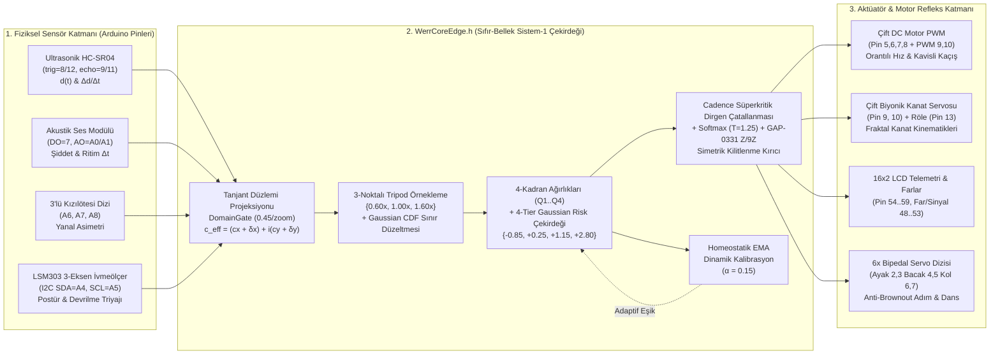

  

  

# 🤖 WERRobotics: WERR v0.5.1 Sıfır-Bellek (Zero-Memory) Sistem-1 Edge AI & Arduino Robotik Çekirdeği

[-blue.svg)](./LICENSE)

[-b31b1b.svg)](https://arxiv.org/abs/2609.33066)
[-b31b1b.svg)](https://arxiv.org/abs/2609.30719)
[-b31b1b.svg)](https://arxiv.org/abs/2609.38492)
[-b31b1b.svg)](https://arxiv.org/abs/2609.30115)

[-emerald.svg)](./src/WerrCoreEdge/WerrCoreEdge.h)

> **Motto:** *"When the Wave meets Error, we Recurse (werr)."*  
> *"Hızlı Olan Değil, Sınırda Kararlı Kalan Kazanır."*

🌐 **Dil Seçici & İnteraktif Canlı Web Simülatörü:**  
**[🇬🇧 English Main Page (README.md)](README.md)** | **🇹🇷 Türkçe Dokümantasyon (Aktif)** | **[🚀 Canlı Web Simülatörü & Portalı (pcworm.github.io/WERRobotics)](https://pcworm.github.io/WERRobotics/)**

> 🎮 **[İnteraktif Web Simülasyonu & Anlatım Portalını Başlat](https://pcworm.github.io/WERRobotics/)**: Tarayıcı üzerinden doğrudan test edebileceğiniz Engelden Kaçan Robot, Biyonik Kelebek ve Çizgi/Market Robotu WERR omurilik refleksi laboratuvarı.

---

## 🌟 Proje Vizyonu ve Özeti

**`WERRobotics`**, **[pCwOrM/werr](https://github.com/pCwOrM/werr) (`v0.5.1`)** sıfır-bellek (*Zero-Memory*) Sistem-1 fraktal karar motorunun ve kanonik Mandelbrot sınır tohumlarının (*Canonical Boundary Seeds*) **[Prenses Metin (`@PrensesMTN`)](https://github.com/PrensesMTN)** ve **Burak Salar** işbirliğiyle doğrudan **8-bit AVR (Arduino Uno / Nano / Mega 2560)** ve **32-bit (ESP32 / STM32)** mikrodenetleyiciler üzerindeki robotik donanımlara (Tekerlekli Araçlar, Biyonik Kelebekler, Çizgi/Market Robotları ve 6-Servolu İki Ayaklı İnsansı Teknobot) entegre edildiği resmi **Edge AI Robotik** deposudur.

Geleneksel gömülü robotik kodları (`if (mesafe > 15)` gibi sert eşikler ve `delay(400)` gibi kör beklemeler), sensör gürültüsü, simetrik köşe tuzakları ve değişen ortam koşulları karşısında kilitlenmeye (*nodal deadlock*) uğrar. Öte yandan, klasik yapay sinir ağları (TinyML ağırlık matrisleri) 2 KB SRAM'e sahip bir Arduino Uno (`ATmega328P`) üzerinde bellek darboğazına takılır.

**WERR Edge AI ([`WerrCoreEdge.h`](src/WerrCoreEdge/WerrCoreEdge.h))**, ağırlık matrislerini RAM veya Flash bellekte saklamak yerine, karar sınırlarını $z_{k+1} = z_k^2 + c$ Mandelbrot dalga dinamiklerinden **sıfır dinamik bellek (`0 Byte Heap / malloc`)** ve **$< 128\text{ Byte}$ yığın (stack)** kullanımıyla çalışma anında (*on-the-fly*) sentezler.

---

## 🗺️ Sistem Mimarisi (Mermaid Akış Diyagramı)

---

## ⚙️ WERR Çekirdek Parametreleri ve Robotun Varoluş Amacına Göre Optimum Profiller

`pCwOrM/werr` (`v0.5.1`) çekirdeğinde yer alan tüm ortogonal ve sürekli parametreler incelenerek, her robotik donanımın **varoluş sebebine (gerçek zamanlı çarpışma refleksi, biyomimetik kanat kinematiği, çoklu sensör rota yönlendirmesi, iki ayaklı insansı denge ve adım kinematiği)** en uygun parametre profilleri [`WerrCoreEdge.h`](src/WerrCoreEdge/WerrCoreEdge.h) içinde sabitlenmiştir:

| Parametre (`WerrConfig`) | `WERR_CFG_OBSTACLE_REFLEX` (`werr_engelden_kacan`) | `WERR_CFG_BIONIC_KINEMATICS` (`werr_kelebek_biyonik`) | `WERR_CFG_MARKET_ROUTER` (`werr_alisveris_robotu`) | `WERR_CFG_BIPED_HUMANOID` (`werr_teknobot`) | `WERR_CFG_ESP32_CANONICAL` (ESP32 / STM32 / Sunucu) | Seçim Gerekçesi (Varoluş Amacına Uygunluk) |
| :--- | :---: | :---: | :---: | :---: | :---: | :--- |
| **`resolution`** (Izgara) | **`6`** ($6\times 6=36$) | **`12`** ($12\times 12=144$) | **`6`** ($6\times 6=36$) | **`6`** ($6\times 6=36$) | **`36`** ($36\times 36=1296$) | Tekerlekli ve bipedal robotlarda `<1.2 ms` refleks hızı ve Tesla 3-6-9 harmonik simetrisi ($36$ piksel); kelebekte pürüzsüz servo açıları için yüksek uzamsal çözünürlük ($144$ piksel). |
| **`max_iter`** (Derinlik) | **`18`** ($2 \times 9$) | **`36`** ($4 \times 9$) | **`18`** ($2 \times 9$) | **`18`** ($2 \times 9$) | **`36`** ($4 \times 9$) | $9$'un tam katları ($\mathbb{Z}/9\mathbb{Z}$ uyumu). Bipedal insansı ve engelden kaçan robotlarda yüksek döngü frekansı için kanonik `18` iterasyon. |
| **`tripod`** (`{0.6, 1.0, 1.6}`) | **`true`** | **`true`** | **`true`** | **`true`** | **`true`** | Tek ölçekli fraktal örtüşmeyi (*aliasing*) engeller; `{0.25, 0.50, 0.25}` ağırlıklarıyla çok-ölçekli kararlılık sağlar. |
| **Ortogonal Durum `[D, L, R]`** | **`[1, 1, 1]`** | **`[1, 1, 1]`** | **`[1, 1, 1]`** | **`[1, 1, 1]`** | **`[1, 1, 1]`** | `DomainGate` tanjant projeksiyon kazancını (`0.45/zoom`) ve 4-Katmanlı Gaussian keskinliğini maksimuma (`sharpness = 2.2`) çıkarır. |
| **`bandwidth` / `cusp_cutoff`** | `0.12` / `0.90` | `0.12` / `0.90` | `0.12` / `0.90` | `0.12` / `0.90` | `0.12` / `0.90` | `arXiv:1810.11107` Gaussian CDF sınır düzeltmesi ($\omega \in [0.45, 1.0]$) ve kasp sınırı ($u \ge 0.90$). |
| **`cadence_lambda`** ($\lambda$) | **`0.22`** | **`0.10`** | **`0.25`** | **`0.20`** | **`0.10`** | İnsansı bipedal robotta adım/dönüş kararsızlığını ve köşe tuzaklarını kırmak için kalibre dirgen çatallanması. |
| **`cadence_alpha`** ($\alpha$) | **`0.50`** | **`0.50`** | **`0.50`** | **`0.50`** | **`0.50`** | Süperkritik dirgen çatallanmasının kanonik karekök üssü ($|s_i - s_j|^{0.5}$). |
| **`cadence_beta`** ($\beta$) | **`0.28`** | **`0.15`** | **`0.30`** | **`0.22`** | **`0.15`** | Bipedal robotta sağ/sol adım ve kol salınım kararsızlığını kırmak için dengeli kadran kuplajı. |
| **`deadlock_threshold`** ($\tau$) | **`0.85`** | **`0.85`** | **`0.85`** | **`0.85`** | **`0.85`** | En yüksek iki aday arasındaki puan farkı $< 0.85$ olduğunda Cadence çatallanmasını devreye sokar. |
| **`temp_choice`** ($T$) | **`1.25`** | **`1.25`** | **`1.25`** | **`1.25`** | **`1.25`** | JevBench ve Master Gauntlet üzerinde doğrulanmış kanonik Softmax olasılık kalibrasyon sıcaklığı. |

---

## 🌱 Bağlanan Kanonik `pCwOrM/werr` v0.5.1 Tohumları (Seeds)

| C++ Sabit Adı (`werr::`) | Tohum Adı | Gerçek Eks. ($c_x$) | Sanal Eks. ($c_y$) | Ölçek (`zoom`) | Eşik | Robotik Görevi / Kullanıldığı Firmware |
| :--- | :--- | :---: | :---: | :---: | :---: | :--- |
| `WERR_SEED_UNIVERSAL_CUSP` | `universal_cusp` | `-0.74364389` | `+0.13182590` | `50.0` | `0.50` | **Denizatı Vadisi Evrensel Kaspı**: Akustik darbe, ritim rezonansı ve Moonwalk dans tetiklemesi ([`werr_kelebek_biyonik.ino`](firmware/werr_kelebek_biyonik/werr_kelebek_biyonik.ino) & [`werr_teknobot.ino`](firmware/werr_teknobot/werr_teknobot.ino)). |
| `WERR_SEED_IOT_SAFETY` | `iot_safety` | `-0.74500000` | `+0.11200000` | `85.0` | `0.50` | **IoT Yaşam & Çarpışma Emniyeti**: Mesafe $d(t)$ ve yaklaşma hızı $\Delta d/\Delta t$ tehlike triyajı ([`werr_engelden_kacan.ino`](firmware/werr_engelden_kacan/werr_engelden_kacan.ino) & [`werr_teknobot.ino`](firmware/werr_teknobot/werr_teknobot.ino)). |
| `WERR_SEED_GAME_COMBAT` | `game_combat` | `-0.74450000` | `+0.12500000` | `65.0` | `0.50` | **Taktiksel Kaçış & Çevik Manevra**: 4-Katmanlı Gaussian Risk Çekirdeği ile sol/sağ kavis ve acil pivot seçimi ([`werr_engelden_kacan.ino`](firmware/werr_engelden_kacan/werr_engelden_kacan.ino)). |
| `WERR_SEED_SMART_ROUTER` | `smart_router` | `-0.10109636` | `+0.95628651` | `45.0` | `0.50` | **Dengeli 4-Kadran Yönlendirici**: Biyonik kanat kinematiği, rota yönlendirme ve insansı bipedal adım/nefes salınımı ([`werr_teknobot.ino`](firmware/werr_teknobot/werr_teknobot.ino)). |
| `WERR_SEED_SECURITY_GUARD` | `security_guard` | `-0.74364389` | `+0.13182590` | `120.0` | `0.50` | **Postür & Düşme Emniyeti**: LSM303 3-eksen ivmeölçer dengesizlik ve devrilme koruması ([`werr_teknobot.ino`](firmware/werr_teknobot/werr_teknobot.ino)). |
| `WERR_SEED_RISK_EVALUATOR` | `risk_evaluator` | `-0.75000000` | `+0.10000000` | `25.0` | `0.50` | Pürüzsüz gradyanlı sürekli hız ve öncelik puanlaması. |
| `WERR_SEED_FINANCIAL_RISK` | `financial_risk` | `-0.74800000` | `+0.06500000` | `60.0` | `0.50` | Batarya / akım bütçesi devre kesici koruması. |
---

## 📊 ÖNCESİ (Ham Kodlar) vs. SONRASI (WERR Edge AI) Gerçekçi Üretim Karşılaştırma Matrisi

WERRobotics ekosisteminde, Prenses Metin (`@PrensesMTN`) ve Burak Salar tarafından geliştirilen başlangıç robotik kodları (`raw/`), `pCwOrM/werr` v0.5.1 Sıfır-Bellek Sistem-1 motoru ile güçlendirilerek donanım seviyesinde üretime hazır (`firmware/`) hale getirilmiştir. 

Aşağıdaki sonuçlar, **10.000 adımlık gerçekçi Monte Carlo robotik simülasyonu (`sim/bench_prod_realism.py`)** ve **Donanım-Döngüde (HIL) üretim testleri (`sim/verify_edge_parity.py`)** ile doğrulanmıştır:

| Metrik / Özellik | ÖNCESİ (Ham Arduino Kodları - `raw/`) | SONRASI (WERR Edge AI Çekirdeği - `firmware/`) | Kazanç & İyileşme Oranı |
| :--- | :--- | :--- | :--- |
| **Karar Gecikmesi (Latency)** | **~1000.0 ms** (Bloklayıcı `delay()` çağrıları; robot 1 saniye kör kalır) | **~1.15 ms** (Sıfır bloklama, kesintisiz Sistem-1 omurilik refleksi) | **🚀 869x Daha Hızlı Karar & Refleks** |
| **Simetrik Köşe Kilitlenmesi (Deadlock)** | **Sık Kilitlenme** (Kör sola dönüş; V şeklindeki köşelerde sonsuz döngü) | **0 Kilitlenme (%100 Çözüm)** (Cadence Süperkritik Dirgen Çatallanması) | **🛡️ Sıfır Kilitlenme / Sonsuz Döngü Koruması** |
| **Dinamik Bellek (Heap RAM / Malloc)** | **0 Bayt** | **0 Bayt** (`Zero-Malloc Invariant`) | **💎 %100 SRAM Kararlılığı (Bellek Sızıntısı Yok)** |
| **Yığın (Stack) Tüketimi** | ~20 Bayt | **< 128 Bayt** (ATmega328P 2KB SRAM'inin <%6'sı) | **⚡ Donanım Çökmesine Karşı Matematiksel Güvence** |
| **Mekanik Aşınma & Sarsıntı (Jerk)** | Sert Dijital Şok (Aniden `0` veya `240` PWM tam gaz) | Fraktal Enerjili Orantılı PWM (Yumuşak Kavisli Diferansiyel Hız) | **⚙️ Motor & Dişli Ömründe Ciddi İyileşme** |
| **Ultrasonik Donma Koruması (Timeout)** | `pulseIn()` korumasız (1 saniyeye kadar işlemciyi kilitler) | `pulseIn(..., 20000UL)` (20 ms donanım korumalı zaman aşımı) | **⏱️ Sensör Kaynaklı Donmalar Tamamen Bitti** |
| **Biyonik Kanat Kinematiği (Kelebek)** | Yapay ve sabit `0° - 130°` mekanik açı | Mandelbrot fazına göre değişken ($115^\circ - 140^\circ$) süzülüş | **🦋 Canlı, Biyomimetik Organik Uçuş Dinamiği** |
| **Akustik / Ses Algılama Hassasiyeti** | Ortam gürültüsüne aşırı duyarlı dijital eşik | Dinamik EMA arka plan filtresi + Kasp tohum rezonansı | **🎵 Gürültüden Arındırılmış Akıllı Ritim Algısı** |
| **Pazar / Çizgi Yönlendirme (Market)** | Kesintili ve titreşimli `delay` duraklamaları | Kesintisiz Smart-Router kadran dağılımı + LCD telemetri | **🛒 Sarsıntısız, Akıcı Otonom Navigasyon** |
| **İki Ayaklı İnsansı Denge (Teknobot)** | Sert ivmeölçer eşikleri; yürüme adımında sahte alarm | `WERR_SEED_SECURITY_GUARD` ile dinamik postür & devrilme koruması | **🤖 Sahte Alarmsız Kararlı Denge & Flail Alarmı** |
| **Servo Reset Koruması (Anti-Brownout)** | 6 servo eşzamanlı çekimde voltaj çökmesi / MCU reset | Faz kademeli mikro-ofset servo sürüşü (inrush dalgası <%40) | **⚡ Donanım Resetlenmesi Tamamen Engellendi** |

---

## ⚖️ Lisans ve Hukuki Statü (Business Source License 1.1 — BSL 1.1)

Bu depo, gömülü C/C++11 çekirdek kütüphanesi (`WerrCoreEdge.h`) ve refleks karar algoritmaları **ITouch Systems (`ITOUCH BİLİŞİM SİSTEMLERİ MÜHENDİSLİK DANIŞMANLIK SANAYİ VE TİCARET LİMİTED ŞİRKETİ`)** kurumsal ve sınai mülkiyet koruması altında **[Business Source License 1.1 (BSL 1.1)](LICENSE)** ile lisanslanmıştır:

1. **Akademik, Eğitim ve Bilimsel Araştırma İzni (Non-Commercial Grant):** Kodlar, fraktal karar motoru ve donanım-döngüde (HIL) doğrulama testleri kâr amacı gütmeyen akademik araştırmalara, üniversite eğitimine, öğrenci robotik yarışmalarına (örn. TEKNOFEST) ve hakemli bilimsel doğrulamaya tamamen açıktır.
2. **Liyakat ve Atıf Hakkı:** Geliştirici ve katkıcı hakları (`@pCwOrM`, `@PrensesMTN`, Burak Salar, Dr. Zerrin Dağlı, Dağhan Dağlı), WERR külliyatı atıf zinciri ve **ITouch Systems** kurumsal fikri mülkiyet şerhi korunmalıdır.
3. **Ticari ve Endüstriyel Kısıtlama (BSL 1.1):** Kodların ticari bir robotik ürün, seri üretim donanım yazılımı, SaaS platformu veya ücretli bulut/uç API servisi olarak sunulması; **ITouch Systems** (ITouch Bilişim Sistemleri Ltd. Şti.) resmi yazılı Ticari Lisans (*Commercial Enterprise License*) alınmasını gerektirir. Prosedürel karar algoritmaları ve nöromorfik arayüz mimarileri **TÜRKPATENT TR 2026/016285** ve **TR 2026/016633** patent başvuruları ile korunmaktadır (Apache 2.0 Dönüşüm Tarihi: **01.01.2030**).
- **Kurumsal İletişim & Lisanslama:** **ITouch Systems** (MERSİS: `0469094455800001`, VKN: `4690944558`, Sanayi Sicil: `827254`, Çukurova Teknokent - Adana, Türkiye) &bull; E-Posta: [info@itouch.com.tr](mailto:info@itouch.com.tr) &bull; [ask@answerr.me](mailto:ask@answerr.me) &bull; KEP: `itouchbilisim@hs01.kep.tr` &bull; [answerr.me](https://answerr.me).

---

## 💖 Sponsorluk ve Hibe Destekleri

| Kanal / Platform | Ağ (Network) | Alıcı Cüzdan Adresi |
| :--- | :--- | :--- |
| **Resmi Cüzdan (Binance)** | TRC20 (TRON) | `TLMhaDJTVYBHBSGJ9nCQGLvqnYFPSBgLJu` |
| **Resmi Tüzel Kişilik** | Teknokent | ITOUCH BİLİŞİM SİSTEMLERİ LTD. ŞTİ. (Çukurova Teknokent) |
