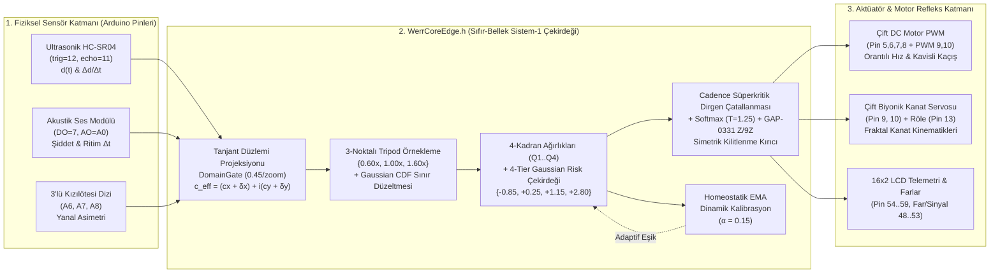

# 🤖 WERRobotics — WERR v0.5.1 Sıfır-Bellek (Zero-Memory) Sistem-1 Edge AI & Arduino Robotik Çekirdeği

  
  
  
  
  
  

  <b>Mandelbrot Dalga Dinamikleri ve Fraktal Sınır Tohumları ile Mikrodenetleyicilerde (ATmega328P / Mega2560 / ESP32) Gerçek Zamanlı Otonom Refleks Karar Mekanizması</b> 
  <i>"When the Wave meets Error, we Recurse (werr)." — "Hızlı Olan Değil, Sınırda Kararlı Kalan Kazanır."</i>

---

## 🌟 Proje Vizyonu ve Özeti

**`WERRobotics`**, **[pCwOrM/werr](https://github.com/pCwOrM/werr) (`v0.5.1`)** sıfır-bellek (*Zero-Memory*) Sistem-1 fraktal karar motorunun ve kanonik Mandelbrot sınır tohumlarının (*Canonical Boundary Seeds*) doğrudan **8-bit AVR (Arduino Uno / Nano / Mega 2560)** ve **32-bit (ESP32 / STM32)** mikrodenetleyiciler üzerindeki robotik donanımlara entegre edildiği resmi **Edge AI Robotik** deposudur.

Geleneksel gömülü robotik kodları (`if (mesafe > 15)` gibi sert eşikler ve `delay(400)` gibi kör beklemeler), sensör gürültüsü, simetrik köşe tuzakları ve değişen ortam koşulları karşısında kilitlenmeye (*nodal deadlock*) uğrar. Öte yandan, klasik yapay sinir ağları (TinyML ağırlık matrisleri) 2 KB SRAM'e sahip bir Arduino Uno (`ATmega328P`) üzerinde bellek darboğazına takılır.

**WERR Edge AI ([`WerrCoreEdge.h`](src/WerrCoreEdge/WerrCoreEdge.h))**, ağırlık matrislerini RAM veya Flash bellekte saklamak yerine, karar sınırlarını $z_{k+1} = z_k^2 + c$ Mandelbrot dalga dinamiklerinden **sıfır dinamik bellek (`0 Byte Heap / malloc`)** ve **$< 128\text{ Byte}$ yığın (stack)** kullanımıyla çalışma anında (*on-the-fly*) sentezler.

---

## 🧬 WERR Ekosistemi ve `WERRobotics`'in Konumu

| Ekosistem Deposu | Katman / Alan | Rolü ve `WERRobotics` Bağlantısı |
| :--- | :--- | :--- |
| **[`pCwOrM/werr`](https://github.com/pCwOrM/werr)** | **Çekirdek Motor (`v0.5.1`)** | 8 Kanonik Tohum, 3-Noktalı Tripod, Sınır Düzeltmeli 4-Kadran, 4-Katmanlı Gaussian Risk Çekirdeği, Cadence Dirgen Çatallanması ve GAP-0331 $\mathbb{Z}/9\mathbb{Z}$ cebiri. |
| **[`pCwOrM/answerr`](https://github.com/pCwOrM/answerr)** | **Sistem-1 / Sistem-2 Köprüsü** | Deliberatif LLM'ler ile `< 1 ms` WERR refleks çekirdeğini birleştiren hibrit bilişsel portal. |
| **[`pCwOrM/mandelbrot-fractal-neural-synthesis`](https://github.com/pCwOrM/mandelbrot-fractal-neural-synthesis)** | **Kuramsal Temel (MFNS & OED)** | Sıfır-depolamalı prosedürel ağırlık türetimi ve Yörünge Hata Dinamikleri (*Orbital Error Dynamics*). |
| **[`pCwOrM/WerrSoma`](https://github.com/pCwOrM/WerrSoma)** | **Biyo-Sentetik Nöromorfik** | 158.000 nöronluk *Drosophila* konnektomu ve GABAerjik homeostatik sönümleme (`werr_kelebek_biyonik` dinlenme döngüsünün ilham kaynağı). |
| **[`pCwOrM/WerrAileronControls`](https://github.com/pCwOrM/WerrAileronControls)** | **Aerodinamik Uçuş Zarfı** | $c = c_x + i c_y$ durum projeksiyonu ve tehlike skoru $S \in [0, 3]$ ile otonom kanatçık mikro-tork sentezi. |
| **[`pCwOrM/werracle`](https://github.com/pCwOrM/werracle)** | **On-Chain Karar Kahini** | Tripod $\mathbb{Z}/9\mathbb{Z}$ (Tesla 3-6-9) modüler değişmezleri ve 40 Lean 4 teoremi. |
| **[`pCwOrM/WerreduR`](https://github.com/pCwOrM/WerreduR)** | **Prosedürel Fraktal Pedagoji** | C++ hızlı Tripod çekirdeği (`werr_tripod_cpp`) ve sınır düzeltme ağırlıkları. |
| **🤖 `pCwOrM/WERRobotics`** | **Fiziksel Edge AI & Robotik** | **Prenses Metin (`@PrensesMTN`)** robotik donanım yazılımlarının WERR v0.5.1 tohumlarıyla fiziksel dünyaya bağlandığı uç birim çekirdeği. |

---

## 🗺️ Sistem Mimarisi (Mermaid Akış Diyagramı)

---

## ⚙️ WERR Çekirdek Parametreleri ve Robotun Varoluş Amacına Göre Optimum Profiller

`pCwOrM/werr` (`v0.5.1`) çekirdeğinde yer alan tüm ortogonal ve sürekli parametreler incelenerek, her robotik donanımın **varoluş sebebine (gerçek zamanlı çarpışma refleksi, biyomimetik kanat kinematiği, çoklu sensör rota yönlendirmesi)** en uygun parametre profilleri [`WerrCoreEdge.h`](src/WerrCoreEdge/WerrCoreEdge.h) içinde sabitlenmiştir:

| Parametre (`WerrConfig`) | `WERR_CFG_OBSTACLE_REFLEX` (`werr_engelden_kacan`) | `WERR_CFG_BIONIC_KINEMATICS` (`werr_kelebek_biyonik`) | `WERR_CFG_MARKET_ROUTER` (`werr_alisveris_robotu`) | `WERR_CFG_ESP32_CANONICAL` (ESP32 / STM32 / Sunucu) | Seçim Gerekçesi (Varoluş Amacına Uygunluk) |
| :--- | :---: | :---: | :---: | :---: | :--- |
| **`resolution`** (Izgara) | **`6`** ($6\times 6=36$) | **`12`** ($12\times 12=144$) | **`6`** ($6\times 6=36$) | **`36`** ($36\times 36=1296$) | Engel kaçan robotta `<1.2 ms` refleks hızı ve Tesla 3-6-9 harmonik simetrisi ($36$ piksel); kelebekte pürüzsüz servo açıları için yüksek uzamsal çözünürlük ($144$ piksel). |
| **`max_iter`** (Derinlik) | **`18`** ($2 \times 9$) | **`36`** ($4 \times 9$) | **`18`** ($2 \times 9$) | **`36`** ($4 \times 9$) | $9$'un tam katları ($\mathbb{Z}/9\mathbb{Z}$ uyumu). Kelebekte kanat süzülüşü için kanonik `36` iterasyon; tekerlekli robotlarda yüksek döngü frekansı için `18` iterasyon. |
| **`tripod`** (`{0.6, 1.0, 1.6}`) | **`true`** | **`true`** | **`true`** | **`true`** | Tek ölçekli fraktal örtüşmeyi (*aliasing*) engeller; `{0.25, 0.50, 0.25}` ağırlıklarıyla çok-ölçekli kararlılık sağlar. |
| **Ortogonal Durum `[D, L, R]`** | **`[1, 1, 1]`** | **`[1, 1, 1]`** | **`[1, 1, 1]`** | **`[1, 1, 1]`** | `DomainGate` tanjant projeksiyon kazancını (`0.45/zoom`) ve 4-Katmanlı Gaussian keskinliğini maksimuma (`sharpness = 2.2`) çıkarır. |
| **`bandwidth` / `cusp_cutoff`** | `0.12` / `0.90` | `0.12` / `0.90` | `0.12` / `0.90` | `0.12` / `0.90` | `arXiv:1810.11107` Gaussian CDF sınır düzeltmesi ($\omega \in [0.45, 1.0]$) ve kasp sınırı ($u \ge 0.90$). |
| **`cadence_lambda`** ($\lambda$) | **`0.22`** | **`0.10`** | **`0.25`** | **`0.10`** | Engelden kaçan ve market robotunda simetrik duvar/kavşak kilitlenmelerini anında kırmak için güçlendirilmiş dirgen çatallanma kuvveti. |
| **`cadence_alpha`** ($\alpha$) | **`0.50`** | **`0.50`** | **`0.50`** | **`0.50`** | Süperkritik dirgen çatallanmasının kanonik karekök üssü ($|s_i - s_j|^{0.5}$). |
| **`cadence_beta`** ($\beta$) | **`0.28`** | **`0.15`** | **`0.30`** | **`0.15`** | Tekerlekli robotlarda sağ/sol kavis kararsızlığını kırmak için artırılmış fraktal kadran alanı ($W_{q,i} - W_{q,j}$) kuplajı. |
| **`deadlock_threshold`** ($\tau$) | **`0.85`** | **`0.85`** | **`0.85`** | **`0.85`** | En yüksek iki aday arasındaki puan farkı $< 0.85$ olduğunda Cadence çatallanmasını devreye sokar. |
| **`temp_choice`** ($T$) | **`1.25`** | **`1.25`** | **`1.25`** | **`1.25`** | JevBench ve Master Gauntlet üzerinde doğrulanmış kanonik Softmax olasılık kalibrasyon sıcaklığı. |

---

## 🌱 Bağlanan Kanonik `pCwOrM/werr` v0.5.1 Tohumları (Seeds)

| C++ Sabit Adı (`werr::`) | Tohum Adı | Gerçek Eks. ($c_x$) | Sanal Eks. ($c_y$) | Ölçek (`zoom`) | Eşik | Robotik Görevi / Kullanıldığı Firmware |
| :--- | :--- | :---: | :---: | :---: | :---: | :--- |
| `WERR_SEED_UNIVERSAL_CUSP` | `universal_cusp` | `-0.74364389` | `+0.13182590` | `50.0` | `0.50` | **Denizatı Vadisi Evrensel Kaspı**: Akustik darbe ve ritim rezonansı (`werr_kelebek_biyonik.ino`). |
| `WERR_SEED_IOT_SAFETY` | `iot_safety` | `-0.74500000` | `+0.11200000` | `85.0` | `0.50` | **IoT Yaşam & Çarpışma Emniyeti**: Mesafe $d(t)$ ve yaklaşma hızı $\Delta d/\Delta t$ tehlike triyajı (`werr_engelden_kacan.ino`). |
| `WERR_SEED_GAME_COMBAT` | `game_combat` | `-0.74450000` | `+0.12500000` | `65.0` | `0.50` | **Taktiksel Kaçış & Çevik Manevra**: 4-Katmanlı Gaussian Risk Çekirdeği ile sol/sağ kavis ve acil pivot seçimi (`werr_engelden_kacan.ino`). |
| `WERR_SEED_SMART_ROUTER` | `smart_router` | `-0.10109636` | `+0.95628651` | `45.0` | `0.50` | **Dengeli 4-Kadran Yönlendirici**: Biyonik kanat kinematikleri (`werr_kelebek_biyonik.ino`) ve 3-sensörlü rota yönlendirme (`werr_alisveris_robotu.ino`). |
| `WERR_SEED_SECURITY_GUARD` | `security_guard` | `-0.74364389` | `+0.13182590` | `120.0` | `0.50` | Yüksek hassasiyetli sınır geçiş koruması ve donanım güvenlik kilidi. |
| `WERR_SEED_RISK_EVALUATOR` | `risk_evaluator` | `-0.75000000` | `+0.10000000` | `25.0` | `0.50` | Pürüzsüz gradyanlı sürekli hız ve öncelik puanlaması. |
| `WERR_SEED_FINANCIAL_RISK` | `financial_risk` | `-0.74800000` | `+0.06500000` | `60.0` | `0.50` | Batarya / akım bütçesi devre kesici koruması. |
| `WERR_SEED_ECOMMERCE_FRAUD` | `ecommerce_fraud` | `-0.74950000` | `+0.08200000` | `70.0` | `0.50` | Sensör anomalisi ve sahte yankı (outlier) filtreleme. |

---

## 📂 Depo Dizin Yapısı ve Doküman Bağlantıları

- **Ana Dokümanlar**:
  - 🇹🇷 [`README_TR.md`](README_TR.md) — Türkçe Ana Dokümantasyon
  - 🇬🇧 [`README.md`](README.md) — İngilizce Ana Dokümantasyon (International Master Edition)
- **Derin Teknik ve Donanım Kılavuzları (`docs/`)**:
  - 🇹🇷 [`docs/WERR_EDGE_ARCHITECTURE_TR.md`](docs/WERR_EDGE_ARCHITECTURE_TR.md) — Matematiksel Model, Optimum Parametre Analizi, Tripod, Cadence ve $\mathbb{Z}/9\mathbb{Z}$ Kılavuzu (Türkçe)
  - 🇬🇧 [`docs/WERR_EDGE_ARCHITECTURE.md`](docs/WERR_EDGE_ARCHITECTURE.md) — Mathematical Model, Optimal Parameter Audit, Tripod, Cadence & $\mathbb{Z}/9\mathbb{Z}$ Guide (English)
  - 🇹🇷 [`docs/HARDWARE_PINOUT_AND_WIRING_TR.md`](docs/HARDWARE_PINOUT_AND_WIRING_TR.md) — Arduino Pin Bağlantıları ve Devre Rehberi (Türkçe)
  - 🇬🇧 [`docs/HARDWARE_PINOUT_AND_WIRING.md`](docs/HARDWARE_PINOUT_AND_WIRING.md) — Hardware Pinout & Wiring Guide (English)
- **Kod Dizinleri**:
  - [`raw/`](raw/) — Değiştirilmemiş orijinal Arduino robotik kodları (`engeldenkacan.ino`, `kelebek.ino`, `alisveris_roboti.ino`, `distance_counting.ino`, `robot_el_backend/main.py`)
  - [`src/WerrCoreEdge/WerrCoreEdge.h`](src/WerrCoreEdge/WerrCoreEdge.h) — WERR v0.5.1 C/C++11 Sıfır-Bellek Edge AI Çekirdek Kütüphanesi
  - [`firmware/`](firmware/) — WERR Tohumları ve Optimum Profilleri Bağlanmış Arduino Yazılımları (`werr_engelden_kacan`, `werr_kelebek_biyonik`, `werr_alisveris_robotu`)
  - [`sim/verify_edge_parity.py`](sim/verify_edge_parity.py) — Python Donanım-Döngüde (HIL) Parite ve Yörünge Doğrulama Paketi

---

## 🎖️ Proje Ekibi, Katkıda Bulunanlar & Akademik Atıf

- **WERR Kuramı & Çekirdek Mimari**: **Volkan Dağlı** ([@pCwOrM](https://github.com/pCwOrM)) — *ITouch Systems / answerr.me* (ORCID: [0009-0000-1587-8703](https://orcid.org/0009-0000-1587-8703))
- **Robotik Donanım & Gömülü Sistem Kodları**: **Prenses Metin** ([@PrensesMTN](https://github.com/PrensesMTN))
- **WERR Araştırma Grubu**: **Volkan Dağlı**, **Zerrin Dağlı** ([0000-0001-9490-6425](https://orcid.org/0000-0001-9490-6425)), **Dağhan Dağlı** ([0009-0003-2492-8313](https://orcid.org/0009-0003-2492-8313))
- **Makale & Kalıcı DOI**: [arXiv:2609.25498](https://arxiv.org/abs/2609.25498) | [Zenodo: 10.5281/zenodo.22939253](https://doi.org/10.5281/zenodo.22939253) | **TÜRKPATENT**: `TR 2026/016633`
