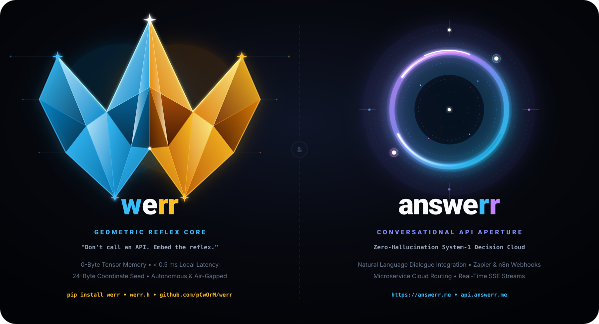
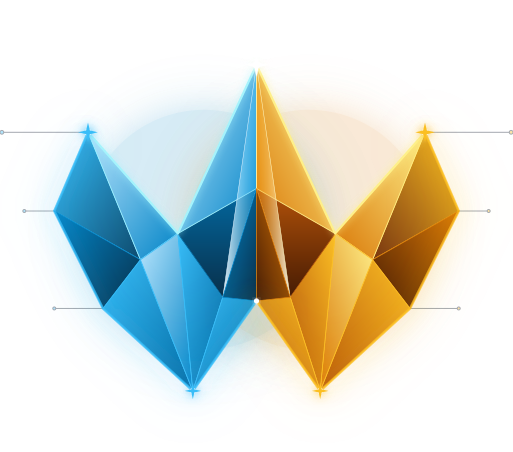
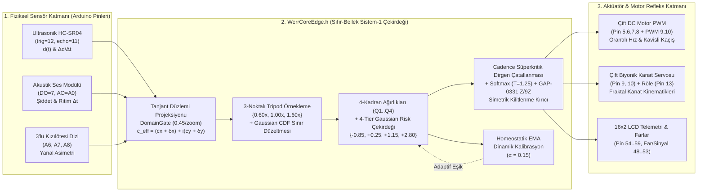

  

  

# 🤖 WERRobotics: WERR v0.5.1 Sıfır-Bellek (Zero-Memory) Sistem-1 Edge AI & Arduino Robotik Çekirdeği

[-blue.svg)](./LICENSE)

[-b31b1b.svg)](https://arxiv.org/abs/2609.33066)
[-b31b1b.svg)](https://arxiv.org/abs/2609.30719)
[-b31b1b.svg)](https://arxiv.org/abs/2609.38492)
[-b31b1b.svg)](https://arxiv.org/abs/2609.30115)

[-emerald.svg)](./src/WerrCoreEdge/WerrCoreEdge.h)

> **Motto:** *"When the Wave meets Error, we Recurse (werr)."*  
> *"Hızlı Olan Değil, Sınırda Kararlı Kalan Kazanır."*

🌐 **Dil Seçici / Language Switcher:**  
**[🇬🇧 English Main Page (README.md)](README.md)** | **🇹🇷 Türkçe Dokümantasyon (Aktif)**

---

## 🌟 Proje Vizyonu ve Özeti

**`WERRobotics`**, **[pCwOrM/werr](https://github.com/pCwOrM/werr) (`v0.5.1`)** sıfır-bellek (*Zero-Memory*) Sistem-1 fraktal karar motorunun ve kanonik Mandelbrot sınır tohumlarının (*Canonical Boundary Seeds*) **[Prenses Metin (`@PrensesMTN`)](https://github.com/PrensesMTN)** işbirliğiyle doğrudan **8-bit AVR (Arduino Uno / Nano / Mega 2560)** ve **32-bit (ESP32 / STM32)** mikrodenetleyiciler üzerindeki robotik donanımlara entegre edildiği resmi **Edge AI Robotik** deposudur.

Geleneksel gömülü robotik kodları (`if (mesafe > 15)` gibi sert eşikler ve `delay(400)` gibi kör beklemeler), sensör gürültüsü, simetrik köşe tuzakları ve değişen ortam koşulları karşısında kilitlenmeye (*nodal deadlock*) uğrar. Öte yandan, klasik yapay sinir ağları (TinyML ağırlık matrisleri) 2 KB SRAM'e sahip bir Arduino Uno (`ATmega328P`) üzerinde bellek darboğazına takılır.

**WERR Edge AI ([`WerrCoreEdge.h`](src/WerrCoreEdge/WerrCoreEdge.h))**, ağırlık matrislerini RAM veya Flash bellekte saklamak yerine, karar sınırlarını $z_{k+1} = z_k^2 + c$ Mandelbrot dalga dinamiklerinden **sıfır dinamik bellek (`0 Byte Heap / malloc`)** ve **$< 128\text{ Byte}$ yığın (stack)** kullanımıyla çalışma anında (*on-the-fly*) sentezler.

---

## 🗺️ Sistem Mimarisi (Mermaid Akış Diyagramı)

---

## ⚙️ WERR Çekirdek Parametreleri ve Robotun Varoluş Amacına Göre Optimum Profiller

`pCwOrM/werr` (`v0.5.1`) çekirdeğinde yer alan tüm ortogonal ve sürekli parametreler incelenerek, her robotik donanımın **varoluş sebebine (gerçek zamanlı çarpışma refleksi, biyomimetik kanat kinematiği, çoklu sensör rota yönlendirmesi)** en uygun parametre profilleri [`WerrCoreEdge.h`](src/WerrCoreEdge/WerrCoreEdge.h) içinde sabitlenmiştir:

| Parametre (`WerrConfig`) | `WERR_CFG_OBSTACLE_REFLEX` (`werr_engelden_kacan`) | `WERR_CFG_BIONIC_KINEMATICS` (`werr_kelebek_biyonik`) | `WERR_CFG_MARKET_ROUTER` (`werr_alisveris_robotu`) | `WERR_CFG_ESP32_CANONICAL` (ESP32 / STM32 / Sunucu) | Seçim Gerekçesi (Varoluş Amacına Uygunluk) |
| :--- | :---: | :---: | :---: | :---: | :--- |
| **`resolution`** (Izgara) | **`6`** ($6\times 6=36$) | **`12`** ($12\times 12=144$) | **`6`** ($6\times 6=36$) | **`36`** ($36\times 36=1296$) | Engel kaçan robotta `<1.2 ms` refleks hızı ve Tesla 3-6-9 harmonik simetrisi ($36$ piksel); kelebekte pürüzsüz servo açıları için yüksek uzamsal çözünürlük ($144$ piksel). |
| **`max_iter`** (Derinlik) | **`18`** ($2 \times 9$) | **`36`** ($4 \times 9$) | **`18`** ($2 \times 9$) | **`36`** ($4 \times 9$) | $9$'un tam katları ($\mathbb{Z}/9\mathbb{Z}$ uyumu). Kelebekte kanat süzülüşü için kanonik `36` iterasyon; tekerlekli robotlarda yüksek döngü frekansı için `18` iterasyon. |
| **`tripod`** (`{0.6, 1.0, 1.6}`) | **`true`** | **`true`** | **`true`** | **`true`** | Tek ölçekli fraktal örtüşmeyi (*aliasing*) engeller; `{0.25, 0.50, 0.25}` ağırlıklarıyla çok-ölçekli kararlılık sağlar. |
| **Ortogonal Durum `[D, L, R]`** | **`[1, 1, 1]`** | **`[1, 1, 1]`** | **`[1, 1, 1]`** | **`[1, 1, 1]`** | `DomainGate` tanjant projeksiyon kazancını (`0.45/zoom`) ve 4-Katmanlı Gaussian keskinliğini maksimuma (`sharpness = 2.2`) çıkarır. |
| **`bandwidth` / `cusp_cutoff`** | `0.12` / `0.90` | `0.12` / `0.90` | `0.12` / `0.90` | `0.12` / `0.90` | `arXiv:1810.11107` Gaussian CDF sınır düzeltmesi ($\omega \in [0.45, 1.0]$) ve kasp sınırı ($u \ge 0.90$). |
| **`cadence_lambda`** ($\lambda$) | **`0.22`** | **`0.10`** | **`0.25`** | **`0.10`** | Engelden kaçan ve market robotunda simetrik duvar/kavşak kilitlenmelerini anında kırmak için güçlendirilmiş dirgen çatallanma kuvveti. |
| **`cadence_alpha`** ($\alpha$) | **`0.50`** | **`0.50`** | **`0.50`** | **`0.50`** | Süperkritik dirgen çatallanmasının kanonik karekök üssü ($|s_i - s_j|^{0.5}$). |
| **`cadence_beta`** ($\beta$) | **`0.28`** | **`0.15`** | **`0.30`** | **`0.15`** | Tekerlekli robotlarda sağ/sol kavis kararsızlığını kırmak için artırılmış fraktal kadran alanı ($W_{q,i} - W_{q,j}$) kuplajı. |
| **`deadlock_threshold`** ($\tau$) | **`0.85`** | **`0.85`** | **`0.85`** | **`0.85`** | En yüksek iki aday arasındaki puan farkı $< 0.85$ olduğunda Cadence çatallanmasını devreye sokar. |
| **`temp_choice`** ($T$) | **`1.25`** | **`1.25`** | **`1.25`** | **`1.25`** | JevBench ve Master Gauntlet üzerinde doğrulanmış kanonik Softmax olasılık kalibrasyon sıcaklığı. |

---

## 🌱 Bağlanan Kanonik `pCwOrM/werr` v0.5.1 Tohumları (Seeds)

| C++ Sabit Adı (`werr::`) | Tohum Adı | Gerçek Eks. ($c_x$) | Sanal Eks. ($c_y$) | Ölçek (`zoom`) | Eşik | Robotik Görevi / Kullanıldığı Firmware |
| :--- | :--- | :---: | :---: | :---: | :---: | :--- |
| `WERR_SEED_UNIVERSAL_CUSP` | `universal_cusp` | `-0.74364389` | `+0.13182590` | `50.0` | `0.50` | **Denizatı Vadisi Evrensel Kaspı**: Akustik darbe ve ritim rezonansı ([`werr_kelebek_biyonik.ino`](firmware/werr_kelebek_biyonik/werr_kelebek_biyonik.ino)). |
| `WERR_SEED_IOT_SAFETY` | `iot_safety` | `-0.74500000` | `+0.11200000` | `85.0` | `0.50` | **IoT Yaşam & Çarpışma Emniyeti**: Mesafe $d(t)$ ve yaklaşma hızı $\Delta d/\Delta t$ tehlike triyajı ([`werr_engelden_kacan.ino`](firmware/werr_engelden_kacan/werr_engelden_kacan.ino)). |
| `WERR_SEED_GAME_COMBAT` | `game_combat` | `-0.74450000` | `+0.12500000` | `65.0` | `0.50` | **Taktiksel Kaçış & Çevik Manevra**: 4-Katmanlı Gaussian Risk Çekirdeği ile sol/sağ kavis ve acil pivot seçimi ([`werr_engelden_kacan.ino`](firmware/werr_engelden_kacan/werr_engelden_kacan.ino)). |
| `WERR_SEED_SMART_ROUTER` | `smart_router` | `-0.10109636` | `+0.95628651` | `45.0` | `0.50` | **Dengeli 4-Kadran Yönlendirici**: Biyonik kanat kinematikleri ([`werr_kelebek_biyonik.ino`](firmware/werr_kelebek_biyonik/werr_kelebek_biyonik.ino)) ve 3-sensörlü rota yönlendirme ([`werr_alisveris_robotu.ino`](firmware/werr_alisveris_robotu/werr_alisveris_robotu.ino)). |
| `WERR_SEED_SECURITY_GUARD` | `security_guard` | `-0.74364389` | `+0.13182590` | `120.0` | `0.50` | Yüksek hassasiyetli sınır geçiş koruması ve donanım güvenlik kilidi. |
| `WERR_SEED_RISK_EVALUATOR` | `risk_evaluator` | `-0.75000000` | `+0.10000000` | `25.0` | `0.50` | Pürüzsüz gradyanlı sürekli hız ve öncelik puanlaması. |
| `WERR_SEED_FINANCIAL_RISK` | `financial_risk` | `-0.74800000` | `+0.06500000` | `60.0` | `0.50` | Batarya / akım bütçesi devre kesici koruması. |
| `WERR_SEED_ECOMMERCE_FRAUD` | `ecommerce_fraud` | `-0.74950000` | `+0.08200000` | `70.0` | `0.50` | Sensör anomalisi ve sahte yankı (outlier) filtreleme. |

---

## ⚖️ Lisans ve Fikri Mülkiyet Hakları (BSL 1.1 — ITouch Systems)

Bu yazılım, gömülü C/C++11 çekirdek kütüphanesi (`WerrCoreEdge.h`) ve refleks karar algoritmaları **ITouch Systems (ITOUCH BİLİŞİM SİSTEMLERİ MÜHENDİSLİK DANIŞMANLIK SANAYİ VE TİCARET LİMİTED ŞİRKETİ)** kurumsal koruması altında **[Business Source License 1.1 (BSL 1.1)](LICENSE)** ile lisanslanmıştır.
- **Akademik, Eğitim, Robotik Kulübü ve Yarışma Kullanımı:** Kâr amacı gütmeyen araştırmalar, üniversite eğitimi, öğrenci toplulukları, Teknofest vb. robotik yarışmaları ve akademik kıyaslamalar için tamamen ücretsiz ve açıktır.
- **Ticari ve Kurumsal Kullanım:** Kodların ticari bir robotik ürün, seri üretim donanım yazılımı, SaaS platformu veya ücretli bulut/uç API servisi olarak sunulması; **ITouch Systems** (ITouch Bilişim Sistemleri Ltd. Şti.) resmi yazılı Ticari Lisans (*Commercial Enterprise License*) alınmasını gerektirir.
- **Patent Koruması:** Prosedürel karar algoritmaları ve nöromorfik arayüz mimarileri **TÜRKPATENT TR 2026/016285** ve **TR 2026/016633** patent başvuruları ile korunmaktadır.
- **Dönüşüm Tarihi:** **01.01.2030** tarihinde bu yazılım otomatik olarak **Apache License, Version 2.0** açık kaynak lisansına dönüşecektir.
- **Kurumsal İletişim & Lisanslama:** **ITouch Systems** (MERSİS: `0469094455800001`, VKN: `4690944558`, Sanayi Sicil: `827254`, Çukurova Teknokent - Adana, Türkiye) &bull; E-Posta: [info@itouch.com.tr](mailto:info@itouch.com.tr) &bull; [ask@answerr.me](mailto:ask@answerr.me) &bull; KEP: `itouchbilisim@hs01.kep.tr` &bull; [answerr.me](https://answerr.me).

---

## 💖 Sponsorluk ve Hibe Destekleri

| Kanal / Platform | Ağ (Network) | Alıcı Cüzdan Adresi |
| :--- | :--- | :--- |
| **Resmi Cüzdan (Binance)** | TRC20 (TRON) | `TLMhaDJTVYBHBSGJ9nCQGLvqnYFPSBgLJu` |
| **Resmi Tüzel Kişilik** | Teknokent | ITOUCH BİLİŞİM SİSTEMLERİ LTD. ŞTİ. (Çukurova Teknokent) |
